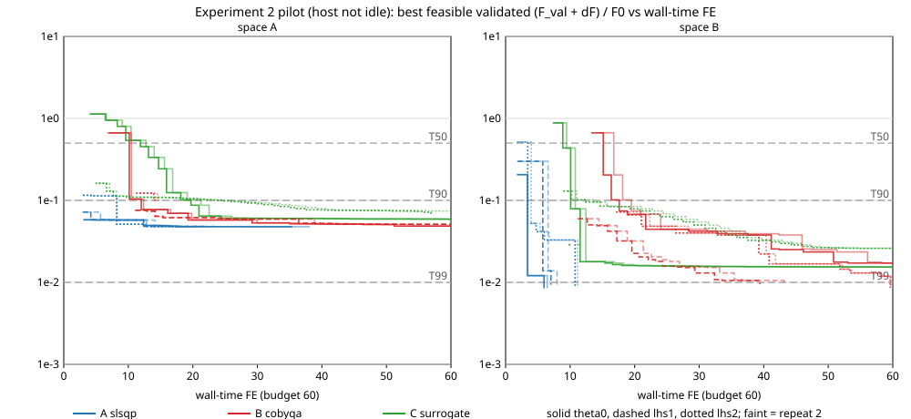

# Experiment 2 pilot (issue #1198, of #1185): feasibility and budget only

**Session `pilot-20261018T041148Z`, label `pilot`, `host_idle: false`.** The pilot checks feasibility and the budget only (#1185 amendments 2 and 3). The targets T50/T90/T99 are fixed and are not revised here. The host was carrying other agents' work, so **no speedup ratio comes from this pilot and none is computed**.

## Session

- Host robb-studio, Apple M3 Ultra, 28 cores. Load averages (1, 5, 15 min) before 11.77, 12.98, 13.22 (2026-10-18T04:05:15Z), after 11.89, 13.58, 25.61 (2026-10-18T06:40:46Z).
- N = 6 single-threaded processes (RAYON_NUM_THREADS = GEODE_NUM_THREADS = 1, faer Par::Seq) for the 36 runs and for the concurrent unit calibration.
- Unit = 37.6637 s: the median of 18 cold θ0 validations in 6 simultaneous processes (amendment 4 addition 6); range 37.545–38.176 s. Single-process median 34.5402 s (diagnostic only). Budget 60 FE = 2259.8 s per run.
- Solve-count weights: training forward 0.3309 FE, adjoint 0.0757 FE per evaluation; validation 1.
- Commit 89e6c4e127a5fbef7e4b2e0f10b90e70bd1193b4 (tree clean: True); rustc 1.98.1 (48a229cea 2026-09-01); Python 3.12.13 (isolated: True); scipy 1.18.1, numpy 2.5.4; requirements.lock SHA-256 10a81655baf72ac96c10fc8e66fc945f8c36a8775b347de752721497de206ff3; evaluator SHA-256 56a6025ec40a0b036cf4ae55a26e84d96e3cedb69294345c862d10c643c421ca.
- Meshes: training L1 c4526a26904c73f68ba0987f0ca8995bcc0095f0e7936399d5920e167f35d7f5, validation L2 00a7eb6f88bd8fdf22e8ad0b406d4889a68c2d269fc3216ff81f255cddb71cf5; anchor.json 715ed8334a48dbed701acfd56f1c738a4574033309240bdea825316ccf4b1f3f. Both meshes were rebuilt and match their committed records (`logs/check_meshes_pilot.log`).
- Anchor F0 = 9.603404147653e-03 N² m²; T50 = 4.801702e-03, T90 = 9.603404e-04, T99 = 9.603404e-05; mean floor 1.444441133740 N m.
- Per-run wall time 225–2298 s; total session wall time in `session_console.log`.

## Findings (written after inspecting the results; feasibility and budget only)

1. **The targets are partly attainable.**
   - **Space B.** Every run of every method attained T50 and T90. T99 was attained by:
     - A (SLSQP): 6/6, at 5.96–11.14 wall-time FE;
     - B (COBYQA): 4/6, at 39.40–59.66 FE. Both θ0 runs were censored by the budget.
     - C (the surrogate): 0/6. Its best was 0.014 F0, and its runs stopped on the budget or failed.

     T99 is therefore not a common target in space B.
   - **Space A.** Every method attained T50 and T90 in at least one run (A 6/6 and 6/6, B 6/6 and 4/6, C 4/6 and 4/6). No run of any method attained T99.
     - The best feasible validated value in space A is about 0.043 F0. SLSQP reaches 0.0433–0.0435 F0 from all three starts.
     - T99 (F_val + δF ≤ 0.01 F0) is censored for every method in space A. Under amendment 2 it stays censored and is not replaced.
2. **Failed runs.** 13 of 36 runs ended `failed`. All six SLSQP runs in space A failed. Two causes, both under the pre-registered rule (amendment 4 ruling 4):
   - **Geometry that cannot be built (11 runs).** The method stepped to a design inside the reference box whose construction cannot be built ("slot flank degenerates").
   - **A remesh below the angle floor (2 runs).** For SLSQP in space A from θ0, both repeats remeshed to a fresh mesh whose minimum angle is 4.88°, below the 5° policy.

   The harness applied these rules as pre-registered, so neither cause is a harness defect, and no run was patched or re-run. Both causes recur identically on the repeats: the same design, the same request.

   **For the main runs, this is a protocol question for the operator, not settled here.** The frozen reference box contains designs that cannot be built, and a failed request ends the run. These two facts decide most space-A outcomes.
3. **Is 60 FE binding?**
   - **Yes, for B and C.** 13 runs stopped on the budget, and their best feasible validated value was still improving: the last improvement came at a median of 58.6 FE. COBYQA's space-B lhs2 runs reached T99 at 59.6–59.7 FE, at the edge of the budget.
   - **No, for A in space B.** It reached T99 in ≤ 11.14 FE.
4. **The repeats differ only in timing.** Each method's path is deterministic, so repeats 1 and 2 differ only in how far a run gets within the budget.
   - C, space A, lhs2: repeat 1 reached its failing request at 56.89 FE. Repeat 2 ran under a heavier load, so it hit the budget at 60 FE before reaching that request, and its best was 0.0672 F0 against 0.0623 F0.
   - C, space A, θ0: the two repeats differ in the 4th digit (0.05356 against 0.05386 F0) for the same reason.
5. **The host was not idle.**
   - During the session, other agents' processes raised the 1-minute load average from about 12 to as high as about 67, on 28 cores. This session contributed 6.
   - The unit, 37.66 s, was measured at a load of about 16, including the 6 calibration processes.
   - In-run validations cost a median of about 0.93 FE each. This rose to about 1.0 FE during the load spike, which shows the slowdown directly (see the host-load table).
6. **Solve-count FE against wall-time FE.** The solve-count weights come from cold θ0 calibration evaluations. In-run evaluations were cheaper:
   - a training forward took a median of about 0.29 FE, against the 0.331 FE weight;
   - a validation took about 0.93 FE, against 1.

   Solve-count FE therefore runs up to about 1.7× wall-time FE at some attainment points (for example COBYQA, space B, lhs1: T50 at 11.18 wall against 19.23 solve). Both counts are reported for every attainment, as amendment 3 §1 requires.
7. **Method C details.**
   - C's surrogate fits cost under 0.01 FE per run (`setup_calibration` and `surrogate_update`). Its cost is its training forwards and validations.
   - Both C runs in space A from lhs1 failed at 6.0–6.7 FE, on training request 12: the third trust-region candidate after the 9-point initial design. None of their 3 validations met the mean floor, so they have no feasible validated value and no curve. Their held-out-current diagnostic was evaluated at the final incumbent, which was infeasible on the validation model.
   - The held-out-current diagnostic (§5) measures **C's linear-in-current interpolation rule**, not intrinsic current generalization.
     - **Against the training model at fraction 0.25, in space A,** the rule over-predicts the torque std by 31–42%. Torque std is not linear in current there.
     - **Against the validation model,** the std error is 1.4–18% at 0.25 and 2–13% at 0.75.
8. **No speedup claim.** No speedup ratio is computed or implied. The host was not idle, and T99 is not common to the methods in either space.

## 1. Attainment by target

Cells: wall-time FE / solve-count FE at the first credited validation that attained the target (F_val + δF ≤ T and the validated mean at or above the floor), or **censored** (not attained within the budget). No finite speedup is computed from a censored cell.

| method | space | start | rep | stop | best feasible F_val / F0 | T50 | T90 | T99 |
|---|---|---|---|---|---|---|---|---|
| A slsqp | A | theta0 | 1 | failed | 0.04336 | 3.02 / 3.22 | 3.02 / 3.22 | censored |
| A slsqp | A | theta0 | 2 | failed | 0.04336 | 3.10 / 3.22 | 3.10 / 3.22 | censored |
| A slsqp | A | lhs1 | 1 | failed | 0.04353 | 2.90 / 3.22 | 2.90 / 3.22 | censored |
| A slsqp | A | lhs1 | 2 | failed | 0.04353 | 3.36 / 3.22 | 3.36 / 3.22 | censored |
| A slsqp | A | lhs2 | 1 | failed | 0.04332 | 2.96 / 3.22 | 8.17 / 8.85 | censored |
| A slsqp | A | lhs2 | 2 | failed | 0.04332 | 2.98 / 3.22 | 8.28 / 8.85 | censored |
| A slsqp | B | theta0 | 1 | T99 | 0.007677 | 1.75 / 1.81 | 3.39 / 3.63 | 5.96 / 6.44 |
| A slsqp | B | theta0 | 2 | T99 | 0.007677 | 1.77 / 1.81 | 3.45 / 3.63 | 6.45 / 6.44 |
| A slsqp | B | lhs1 | 1 | T99 | 0.008502 | 1.79 / 1.81 | 5.75 / 6.03 | 7.03 / 7.44 |
| A slsqp | B | lhs1 | 2 | T99 | 0.008502 | 2.11 / 1.81 | 6.57 / 6.03 | 7.97 / 7.44 |
| A slsqp | B | lhs2 | 1 | T99 | 0.007797 | 3.43 / 3.63 | 3.43 / 3.63 | 10.78 / 11.07 |
| A slsqp | B | lhs2 | 2 | T99 | 0.007797 | 3.96 / 3.63 | 3.96 / 3.63 | 11.14 / 11.07 |
| B cobyqa | A | theta0 | 1 | budget | 0.04417 | 10.15 / 9.94 | 12.01 / 11.93 | censored |
| B cobyqa | A | theta0 | 2 | budget | 0.04417 | 10.47 / 9.94 | 12.38 / 11.93 | censored |
| B cobyqa | A | lhs1 | 1 | budget | 0.04654 | 11.06 / 11.95 | 11.06 / 11.95 | censored |
| B cobyqa | A | lhs1 | 2 | budget | 0.04654 | 11.09 / 11.95 | 11.09 / 11.95 | censored |
| B cobyqa | A | lhs2 | 1 | failed | 0.09163 | 11.17 / 12.28 | censored | censored |
| B cobyqa | A | lhs2 | 2 | failed | 0.09163 | 11.69 / 12.28 | censored | censored |
| B cobyqa | B | theta0 | 1 | budget | 0.01563 | 15.13 / 15.24 | 17.61 / 17.90 | censored |
| B cobyqa | B | theta0 | 2 | budget | 0.01563 | 16.76 / 15.24 | 19.50 / 17.90 | censored |
| B cobyqa | B | lhs1 | 1 | T99 | 0.008666 | 11.18 / 19.23 | 11.18 / 19.23 | 39.40 / 49.78 |
| B cobyqa | B | lhs1 | 2 | T99 | 0.008666 | 12.78 / 19.23 | 12.78 / 19.23 | 43.16 / 49.78 |
| B cobyqa | B | lhs2 | 1 | T99 | 0.007798 | 17.11 / 18.57 | 17.11 / 18.57 | 59.66 / 62.66 |
| B cobyqa | B | lhs2 | 2 | T99 | 0.007798 | 19.09 / 18.57 | 19.09 / 18.57 | 59.56 / 62.66 |
| C surrogate | A | theta0 | 1 | budget | 0.05356 | 11.88 / 11.62 | 19.71 / 19.93 | censored |
| C surrogate | A | theta0 | 2 | budget | 0.05386 | 12.74 / 11.62 | 21.24 / 19.93 | censored |
| C surrogate | A | lhs1 | 1 | failed | — | censored | censored | censored |
| C surrogate | A | lhs1 | 2 | failed | — | censored | censored | censored |
| C surrogate | A | lhs2 | 1 | failed | 0.06228 | 4.89 / 5.31 | 23.35 / 29.57 | censored |
| C surrogate | A | lhs2 | 2 | budget | 0.06719 | 5.37 / 5.31 | 24.56 / 29.57 | censored |
| C surrogate | B | theta0 | 1 | budget | 0.01398 | 8.86 / 8.95 | 10.08 / 10.28 | censored |
| C surrogate | B | theta0 | 2 | budget | 0.01401 | 9.45 / 8.95 | 10.79 / 10.28 | censored |
| C surrogate | B | lhs1 | 1 | failed | 0.02612 | 9.75 / 11.28 | 9.75 / 11.28 | censored |
| C surrogate | B | lhs1 | 2 | failed | 0.02612 | 11.13 / 11.28 | 11.13 / 11.28 | censored |
| C surrogate | B | lhs2 | 1 | budget | 0.02365 | 8.92 / 9.95 | 12.41 / 13.60 | censored |
| C surrogate | B | lhs2 | 2 | budget | 0.02365 | 9.66 / 9.95 | 13.53 / 13.60 | censored |

Attainment fractions (runs that attained / runs):

| method | space | T50 | T90 | T99 |
|---|---|---|---|---|
| A slsqp | A | 6/6 | 6/6 | 0/6 |
| A slsqp | B | 6/6 | 6/6 | 6/6 |
| B cobyqa | A | 6/6 | 4/6 | 0/6 |
| B cobyqa | B | 6/6 | 6/6 | 4/6 |
| C surrogate | A | 4/6 | 4/6 | 0/6 |
| C surrogate | B | 6/6 | 6/6 | 0/6 |

## 2. Budget profile

Mean wall-time FE per run in each ledger category (all runs of the method in the space; every run's categories sum to its total). `overhead` is the remaining wall time: process start-up, I/O and the optimizer's own work (amendment 4 §5).

| method | space | setup_calibration | forward | adjoint | line_search | mesh_motion | remesh | validation | surrogate_update | overhead | total | train evals | remeshes | validations |
|---|---|---|---|---|---|---|---|---|---|---|---|---|---|---|
| A slsqp | A | 0.00 | 5.18 | 2.08 | 3.46 | 0.00 | 0.49 | 14.61 | 0.00 | 0.01 | 25.85 | 27.7 | 2.7 | 15.3 |
| A slsqp | B | 0.00 | 2.01 | 0.58 | 0.35 | 0.00 | 0.19 | 5.08 | 0.00 | 0.01 | 8.22 | 7.3 | 0.7 | 5.3 |
| B cobyqa | A | 0.00 | 32.97 | 0.00 | 0.00 | 0.01 | 0.15 | 11.70 | 0.00 | 0.02 | 44.84 | 104.3 | 1.7 | 12.3 |
| B cobyqa | B | 0.00 | 36.38 | 0.00 | 0.00 | 0.01 | 0.39 | 16.83 | 0.00 | 0.02 | 53.63 | 119.8 | 1.7 | 17.3 |
| C surrogate | A | 0.00 | 16.53 | 0.00 | 0.00 | 0.01 | 0.70 | 24.34 | 0.00 | 0.02 | 41.60 | 59.5 | 1.0 | 24.8 |
| C surrogate | B | 0.00 | 21.64 | 0.00 | 0.00 | 0.01 | 0.55 | 21.36 | 0.00 | 0.02 | 43.58 | 68.5 | 1.3 | 21.7 |

The same split as a share of each method's charged FE (both spaces pooled):

| method | setup_calibration | forward | adjoint | line_search | mesh_motion | remesh | validation | surrogate_update | overhead |
|---|---|---|---|---|---|---|---|---|---|
| A slsqp | 0.0% | 21.1% | 7.8% | 11.2% | 0.0% | 2.0% | 57.8% | 0.0% | 0.1% |
| B cobyqa | 0.0% | 70.4% | 0.0% | 0.0% | 0.0% | 0.6% | 29.0% | 0.0% | 0.0% |
| C surrogate | 0.0% | 44.8% | 0.0% | 0.0% | 0.0% | 1.5% | 53.6% | 0.0% | 0.0% |

## 3. Feasibility

- **Space A.** Attained by at least one run of every method: T50, T90. Attained by every run of every method: none. Attained by no run of any method: T99.
- **Space B.** Attained by at least one run of every method: T50, T90. Attained by every run of every method: T50, T90. Attained by no run of any method: none.

Stop reasons (runs per cell):

| method | space | stop reasons |
|---|---|---|
| A slsqp | A | failed 6 |
| A slsqp | B | T99 6 |
| B cobyqa | A | budget 4, failed 2 |
| B cobyqa | B | T99 4, budget 2 |
| C surrogate | A | budget 3, failed 3 |
| C surrogate | B | budget 4, failed 2 |

**Is 60 FE binding?** 13 of 36 runs stopped on the budget. Among the budget-stopped runs with a feasible validation, the last improvement of the best feasible validated value came at a median of 58.6 FE (range 42.2–60.0 FE). A target censored in a budget-stopped run is censored by the budget; a target censored in a run that stopped on its own (`converged`) or `failed` is censored by that stop, not by the budget.

**Failures.** 13 of 36 runs ended `failed` (a request returned an error; amendment 4 ruling 4: recorded, counted against the method, never re-run).

| run | FE at failure | failing request | cause | targets attained before |
|---|---|---|---|---|
| slsqp_a_theta0_r1 | 35.40 | train (training request 45) | fresh mesh fails the remesh policy | T50, T90 |
| slsqp_a_theta0_r2 | 38.14 | train (training request 45) | fresh mesh fails the remesh policy | T50, T90 |
| slsqp_a_lhs1_r1 | 21.58 | train (training request 25) | no geometry: slot flank degenerates | T50, T90 |
| slsqp_a_lhs1_r2 | 23.39 | train (training request 25) | no geometry: slot flank degenerates | T50, T90 |
| slsqp_a_lhs2_r1 | 17.92 | train (training request 16) | no geometry: slot flank degenerates | T50, T90 |
| slsqp_a_lhs2_r2 | 18.65 | train (training request 16) | no geometry: slot flank degenerates | T50, T90 |
| cobyqa_a_lhs2_r1 | 14.25 | train (training request 30) | no geometry: slot flank degenerates | T50 |
| cobyqa_a_lhs2_r2 | 14.78 | train (training request 30) | no geometry: slot flank degenerates | T50 |
| surrogate_a_lhs1_r1 | 6.04 | train (training request 12) | no geometry: slot flank degenerates | none |
| surrogate_a_lhs1_r2 | 6.66 | train (training request 12) | no geometry: slot flank degenerates | none |
| surrogate_a_lhs2_r1 | 56.89 | train (training request 89) | no geometry: slot flank degenerates | T50, T90 |
| surrogate_b_lhs1_r1 | 10.03 | train (training request 24) | no geometry: slot flank degenerates | T50, T90 |
| surrogate_b_lhs1_r2 | 11.44 | train (training request 24) | no geometry: slot flank degenerates | T50, T90 |

**Host load and timing.** Each run's 1-minute load average at its start and end, the median wall-time FE of its validation evaluations (1 would equal the unit), and the ratio of its solve-count FE to its wall-time FE.

| run | load start | load end | validation FE per evaluation | solve FE / wall FE |
|---|---|---|---|---|
| slsqp_a_theta0_r1 | 16.7 | 19.8 | 0.907 | 1.07 |
| cobyqa_a_theta0_r1 | 16.7 | 17.5 | 0.910 | 1.02 |
| surrogate_a_theta0_r1 | 16.7 | 17.5 | 0.913 | 1.05 |
| slsqp_a_lhs1_r1 | 16.7 | 18.5 | 0.906 | 1.05 |
| cobyqa_a_lhs1_r1 | 16.7 | 17.5 | 0.903 | 1.12 |
| surrogate_a_lhs1_r1 | 16.7 | 38.3 | 0.885 | 1.10 |
| slsqp_a_lhs2_r1 | 38.3 | 18.5 | 0.905 | 1.07 |
| cobyqa_a_lhs2_r1 | 18.5 | 18.3 | 0.895 | 1.09 |
| surrogate_a_lhs2_r1 | 18.5 | 17.5 | 0.910 | 1.20 |
| slsqp_b_theta0_r1 | 19.8 | 17.6 | 0.900 | 1.08 |
| cobyqa_b_theta0_r1 | 18.3 | 27.7 | 0.920 | 1.01 |
| surrogate_b_theta0_r1 | 17.6 | 27.2 | 0.872 | 1.07 |
| slsqp_b_lhs1_r1 | 17.5 | 16.5 | 0.881 | 1.06 |
| cobyqa_b_lhs1_r1 | 17.5 | 24.9 | 0.856 | 1.26 |
| surrogate_b_lhs1_r1 | 17.5 | 17.0 | 0.860 | 1.16 |
| slsqp_b_lhs2_r1 | 16.5 | 30.3 | 0.900 | 1.03 |
| cobyqa_b_lhs2_r1 | 17.0 | 27.8 | 0.944 | 1.05 |
| surrogate_b_lhs2_r1 | 30.3 | 35.4 | 0.980 | 0.99 |
| surrogate_a_theta0_r2 | 17.5 | 30.1 | 0.946 | 0.97 |
| cobyqa_a_theta0_r2 | 27.7 | 22.5 | 0.939 | 0.98 |
| slsqp_a_theta0_r2 | 24.9 | 52.0 | 0.946 | 0.99 |
| surrogate_a_lhs1_r2 | 27.2 | 25.6 | 0.918 | 1.00 |
| cobyqa_a_lhs1_r2 | 25.6 | 60.5 | 0.936 | 1.04 |
| slsqp_a_lhs1_r2 | 31.4 | 22.2 | 0.936 | 0.97 |
| surrogate_a_lhs2_r2 | 52.0 | 58.7 | 1.014 | 1.07 |
| cobyqa_a_lhs2_r2 | 35.4 | 20.5 | 0.901 | 1.06 |
| slsqp_a_lhs2_r2 | 29.1 | 57.2 | 0.927 | 1.02 |
| surrogate_b_theta0_r2 | 20.5 | 30.6 | 0.976 | 1.00 |
| cobyqa_b_theta0_r2 | 22.2 | 26.5 | 1.021 | 0.94 |
| slsqp_b_theta0_r2 | 22.5 | 55.3 | 0.981 | 1.00 |
| surrogate_b_lhs1_r2 | 55.3 | 60.6 | 1.024 | 1.01 |
| cobyqa_b_lhs1_r2 | 57.2 | 54.7 | 0.959 | 1.15 |
| slsqp_b_lhs1_r2 | 60.5 | 59.1 | 0.992 | 0.93 |
| surrogate_b_lhs2_r2 | 60.6 | 13.2 | 0.964 | 1.00 |
| cobyqa_b_lhs2_r2 | 59.1 | 11.9 | 0.983 | 1.05 |
| slsqp_b_lhs2_r2 | 58.7 | 41.3 | 0.967 | 0.99 |

All 581 in-run validation evaluations: median 0.927 FE, range 0.804–2.006 FE.

## 4. Quality versus cost

Each curve is one run: the best feasible validated F_val + δF (the quantity that is compared with each target), divided by F0, against the cumulative wall-time FE of its credited validations; it is drawn to the run's final charged FE. The dashed grey lines are the targets. A run with no feasible validation has no curve. The data, with the solve-count FE as well, is `curves.csv`.

## 5. Method C: held-out-current diagnostic (amendment 6 §3 and addendum)

**Rule.** Method C models currents 0, 0.5 and 1 only. Its prediction at the held-out currents 0.25 and 0.75 is the **linear interpolation in the current fraction** between C's own per-current RBF std predictions at the two neighbouring modelled currents (0 and 0.5 for 0.25; 0.5 and 1 for 0.75). The means at 0 and 0.5, which C does not model, come from cubic RBFs fitted after the run to the same training data. This measures **C's interpolation in current under that rule**, not intrinsic current generalization: torque std need not be linear in current, so a large error here reflects the rule. The diagnostic runs after the run stops and is not counted in its budget or attainment.

| run | fraction | std pred | std train | rel. err. (train) | std val | rel. err. (val) | mean pred | mean val | rel. err. (val) |
|---|---|---|---|---|---|---|---|---|---|
| surrogate_a_theta0_r1 | 0.25 | 6.0515e-03 | 4.5286e-03 | 0.336 | 5.3456e-03 | 0.132 | 0.32851 | 0.31249 | 0.0512 |
| surrogate_a_theta0_r1 | 0.75 | 1.3929e-02 | 1.4115e-02 | 0.013 | 1.5520e-02 | 0.103 | 1.05223 | 1.03375 | 0.0179 |
| surrogate_a_theta0_r2 | 0.25 | 6.0602e-03 | 4.5453e-03 | 0.333 | 5.3649e-03 | 0.130 | 0.32850 | 0.31248 | 0.0513 |
| surrogate_a_theta0_r2 | 0.75 | 1.3969e-02 | 1.4149e-02 | 0.013 | 1.5554e-02 | 0.102 | 1.05220 | 1.03375 | 0.0179 |
| surrogate_a_lhs1_r1 | 0.25 | 5.3787e-03 | 4.0974e-03 | 0.313 | 4.8707e-03 | 0.104 | 0.30229 | 0.28564 | 0.0583 |
| surrogate_a_lhs1_r1 | 0.75 | 1.2889e-02 | 1.3009e-02 | 0.009 | 1.4323e-02 | 0.100 | 0.97625 | 0.95696 | 0.0202 |
| surrogate_a_lhs1_r2 | 0.25 | 5.3787e-03 | 4.0974e-03 | 0.313 | 4.8707e-03 | 0.104 | 0.30229 | 0.28564 | 0.0583 |
| surrogate_a_lhs1_r2 | 0.75 | 1.2889e-02 | 1.3009e-02 | 0.009 | 1.4323e-02 | 0.100 | 0.97625 | 0.95696 | 0.0202 |
| surrogate_a_lhs2_r1 | 0.25 | 6.2636e-03 | 4.4174e-03 | 0.418 | 5.2970e-03 | 0.182 | 0.33047 | 0.31539 | 0.0478 |
| surrogate_a_lhs2_r1 | 0.75 | 1.4894e-02 | 1.5281e-02 | 0.025 | 1.6723e-02 | 0.109 | 1.05432 | 1.03685 | 0.0168 |
| surrogate_a_lhs2_r2 | 0.25 | 6.3339e-03 | 4.5274e-03 | 0.399 | 5.4724e-03 | 0.157 | 0.33032 | 0.31519 | 0.0480 |
| surrogate_a_lhs2_r2 | 0.75 | 1.5380e-02 | 1.5674e-02 | 0.019 | 1.7237e-02 | 0.108 | 1.05403 | 1.03652 | 0.0169 |
| surrogate_b_theta0_r1 | 0.25 | 3.2157e-03 | 2.7730e-03 | 0.160 | 3.4170e-03 | 0.059 | 0.33880 | 0.32748 | 0.0346 |
| surrogate_b_theta0_r1 | 0.75 | 7.4834e-03 | 7.3492e-03 | 0.018 | 7.6666e-03 | 0.024 | 1.06250 | 1.04952 | 0.0124 |
| surrogate_b_theta0_r2 | 0.25 | 3.2157e-03 | 2.7690e-03 | 0.161 | 3.4166e-03 | 0.059 | 0.33880 | 0.32747 | 0.0346 |
| surrogate_b_theta0_r2 | 0.75 | 7.4846e-03 | 7.3479e-03 | 0.019 | 7.6652e-03 | 0.024 | 1.06250 | 1.04951 | 0.0124 |
| surrogate_b_lhs1_r1 | 0.25 | 4.9246e-03 | 5.8484e-03 | 0.158 | 5.9584e-03 | 0.174 | 0.37340 | 0.36571 | 0.0210 |
| surrogate_b_lhs1_r1 | 0.75 | 1.0198e-02 | 8.9590e-03 | 0.138 | 8.9988e-03 | 0.133 | 1.14988 | 1.14008 | 0.0086 |
| surrogate_b_lhs1_r2 | 0.25 | 4.9246e-03 | 5.8484e-03 | 0.158 | 5.9584e-03 | 0.174 | 0.37340 | 0.36571 | 0.0210 |
| surrogate_b_lhs1_r2 | 0.75 | 1.0198e-02 | 8.9590e-03 | 0.138 | 8.9988e-03 | 0.133 | 1.14988 | 1.14008 | 0.0086 |
| surrogate_b_lhs2_r1 | 0.25 | 3.5774e-03 | 2.9159e-03 | 0.227 | 3.6277e-03 | 0.014 | 0.34738 | 0.34018 | 0.0211 |
| surrogate_b_lhs2_r1 | 0.75 | 9.6258e-03 | 9.2345e-03 | 0.042 | 9.8357e-03 | 0.021 | 1.07108 | 1.06297 | 0.0076 |
| surrogate_b_lhs2_r2 | 0.25 | 3.5774e-03 | 2.9159e-03 | 0.227 | 3.6277e-03 | 0.014 | 0.34738 | 0.34018 | 0.0211 |
| surrogate_b_lhs2_r2 | 0.75 | 9.6258e-03 | 9.2340e-03 | 0.042 | 9.8357e-03 | 0.021 | 1.07108 | 1.06297 | 0.0076 |

- Fraction 0.25: relative std error against the validation model, median 0.117, range 0.014–0.182 (12 runs).
- Fraction 0.75: relative std error against the validation model, median 0.101, range 0.021–0.133 (12 runs).

## 6. Per-run table and notes (summarize_session.py)

- Host: robb-studio, Apple M3 Ultra, 28 cores; load averages before 11.77, 12.98, 13.22, after 11.89, 13.58, 25.61; idle: False.
- Processes: 6 single-threaded; commit 89e6c4e127 (tree clean: True); rustc 1.98.1 (48a229cea 2026-09-01); scipy 1.18.1, numpy 2.5.4; lock 10a81655baf7.
- Unit: 37.6637 s, the median of 18 cold θ0 validations in 6 simultaneous processes (range 37.5453–38.1765 s); single-process median 34.5402 s (diagnostic); training forward 0.3309 FE, adjoint 0.0757 FE per evaluation; budget 60 FE.

| run | stop | wall FE | solve FE | train | remesh | valid. | best feasible F_val | T50 | T90 | T99 |
|---|---|---|---|---|---|---|---|---|---|---|
| slsqp_a_theta0_r1 | failed | 35.402 | 37.89 | 44 | 4 | 20 | 4.1639e-04 | 3.02 / 3.22 | 3.02 / 3.22 | censored |
| cobyqa_a_theta0_r1 | budget | 60.000 | 61.33 | 140 | 1 | 15 | 4.2419e-04 | 10.15 / 9.94 | 12.01 / 11.93 | censored |
| surrogate_a_theta0_r1 | budget | 60.000 | 63.13 | 82 | 0 | 36 | 5.1438e-04 | 11.88 / 11.62 | 19.71 / 19.93 | censored |
| slsqp_a_lhs1_r1 | failed | 21.581 | 22.76 | 24 | 2 | 13 | 4.1802e-04 | 2.90 / 3.22 | 2.90 / 3.22 | censored |
| cobyqa_a_lhs1_r1 | budget | 60.000 | 67.29 | 155 | 3 | 16 | 4.4692e-04 | 11.06 / 11.95 | 11.06 / 11.95 | censored |
| surrogate_a_lhs1_r1 | failed | 6.043 | 6.64 | 11 | 1 | 3 | — | censored | censored | censored |
| slsqp_a_lhs2_r1 | failed | 17.920 | 19.10 | 15 | 2 | 13 | 4.1600e-04 | 2.96 / 3.22 | 8.17 / 8.85 | censored |
| cobyqa_a_lhs2_r1 | failed | 14.248 | 15.60 | 29 | 1 | 6 | 8.7999e-04 | 11.17 / 12.28 | censored | censored |
| surrogate_a_lhs2_r1 | failed | 56.894 | 68.12 | 88 | 2 | 39 | 5.9812e-04 | 4.89 / 5.31 | 23.35 / 29.57 | censored |
| slsqp_b_theta0_r1 | T99 | 5.962 | 6.44 | 6 | 0 | 4 | 7.3726e-05 | 1.75 / 1.81 | 3.39 / 3.63 | 5.96 / 6.44 |
| cobyqa_b_theta0_r1 | budget | 60.000 | 60.66 | 138 | 0 | 15 | 1.5013e-04 | 15.13 / 15.24 | 17.61 / 17.90 | censored |
| surrogate_b_theta0_r1 | budget | 60.000 | 64.10 | 97 | 0 | 32 | 1.3430e-04 | 8.86 / 8.95 | 10.08 / 10.28 | censored |
| slsqp_b_lhs1_r1 | T99 | 7.033 | 7.44 | 6 | 1 | 5 | 8.1652e-05 | 1.79 / 1.81 | 5.75 / 6.03 | 7.03 / 7.44 |
| cobyqa_b_lhs1_r1 | T99 | 39.396 | 49.78 | 90 | 2 | 20 | 8.3220e-05 | 11.18 / 19.23 | 11.18 / 19.23 | 39.40 / 49.78 |
| surrogate_b_lhs1_r1 | failed | 10.033 | 11.61 | 23 | 1 | 4 | 2.5085e-04 | 9.75 / 11.28 | 9.75 / 11.28 | censored |
| slsqp_b_lhs2_r1 | T99 | 10.778 | 11.07 | 10 | 1 | 7 | 7.4881e-05 | 3.43 / 3.63 | 3.43 / 3.63 | 10.78 / 11.07 |
| cobyqa_b_lhs2_r1 | T99 | 59.664 | 62.66 | 138 | 3 | 17 | 7.4891e-05 | 17.11 / 18.57 | 17.11 / 18.57 | 59.66 / 62.66 |
| surrogate_b_lhs2_r1 | budget | 60.000 | 59.12 | 88 | 3 | 30 | 2.2712e-04 | 8.92 / 9.95 | 12.41 / 13.60 | censored |
| surrogate_a_theta0_r2 | budget | 60.000 | 58.14 | 79 | 0 | 32 | 5.1727e-04 | 12.74 / 11.62 | 21.24 / 19.93 | censored |
| cobyqa_a_theta0_r2 | budget | 60.000 | 58.68 | 132 | 1 | 15 | 4.2419e-04 | 10.47 / 9.94 | 12.38 / 11.93 | censored |
| slsqp_a_theta0_r2 | failed | 38.138 | 37.89 | 44 | 4 | 20 | 4.1639e-04 | 3.10 / 3.22 | 3.10 / 3.22 | censored |
| surrogate_a_lhs1_r2 | failed | 6.665 | 6.64 | 11 | 1 | 3 | — | censored | censored | censored |
| cobyqa_a_lhs1_r2 | budget | 60.000 | 62.66 | 141 | 3 | 16 | 4.4692e-04 | 11.09 / 11.95 | 11.09 / 11.95 | censored |
| slsqp_a_lhs1_r2 | failed | 23.387 | 22.76 | 24 | 2 | 13 | 4.1802e-04 | 3.36 / 3.22 | 3.36 / 3.22 | censored |
| surrogate_a_lhs2_r2 | budget | 60.000 | 64.46 | 86 | 2 | 36 | 6.4525e-04 | 5.37 / 5.31 | 24.56 / 29.57 | censored |
| cobyqa_a_lhs2_r2 | failed | 14.780 | 15.60 | 29 | 1 | 6 | 8.7999e-04 | 11.69 / 12.28 | censored | censored |
| slsqp_a_lhs2_r2 | failed | 18.649 | 19.10 | 15 | 2 | 13 | 4.1600e-04 | 2.98 / 3.22 | 8.28 / 8.85 | censored |
| surrogate_b_theta0_r2 | budget | 60.000 | 59.78 | 90 | 0 | 30 | 1.3450e-04 | 9.45 / 8.95 | 10.79 / 10.28 | censored |
| cobyqa_b_theta0_r2 | budget | 60.000 | 56.36 | 125 | 0 | 15 | 1.5013e-04 | 16.76 / 15.24 | 19.50 / 17.90 | censored |
| slsqp_b_theta0_r2 | T99 | 6.449 | 6.44 | 6 | 0 | 4 | 7.3726e-05 | 1.77 / 1.81 | 3.45 / 3.63 | 6.45 / 6.44 |
| surrogate_b_lhs1_r2 | failed | 11.442 | 11.61 | 23 | 1 | 4 | 2.5085e-04 | 11.13 / 11.28 | 11.13 / 11.28 | censored |
| cobyqa_b_lhs1_r2 | T99 | 43.161 | 49.78 | 90 | 2 | 20 | 8.3220e-05 | 12.78 / 19.23 | 12.78 / 19.23 | 43.16 / 49.78 |
| slsqp_b_lhs1_r2 | T99 | 7.974 | 7.44 | 6 | 1 | 5 | 8.1652e-05 | 2.11 / 1.81 | 6.57 / 6.03 | 7.97 / 7.44 |
| surrogate_b_lhs2_r2 | budget | 60.000 | 59.78 | 90 | 3 | 30 | 2.2712e-04 | 9.66 / 9.95 | 13.53 / 13.60 | censored |
| cobyqa_b_lhs2_r2 | T99 | 59.565 | 62.66 | 138 | 3 | 17 | 7.4891e-05 | 19.09 / 18.57 | 19.09 / 18.57 | 59.56 / 62.66 |
| slsqp_b_lhs2_r2 | T99 | 11.141 | 11.07 | 10 | 1 | 7 | 7.4881e-05 | 3.96 / 3.63 | 3.96 / 3.63 | 11.14 / 11.07 |

Attainment cells are wall-time FE / solve-count FE at the first validation that attained the target, within the budget. Method C is an empirical RBF surrogate, not a reduced physical or waveform model (#1185 amendment 6).
- cobyqa_a_theta0_r1: budget abort during a validate request (validation).
- surrogate_a_theta0_r1: budget abort during a train request (forward).
- cobyqa_a_lhs1_r1: budget abort during a train request (forward).
- cobyqa_b_theta0_r1: budget abort during a train request (forward).
- surrogate_b_theta0_r1: budget abort during a validate request (validation).
- surrogate_b_lhs2_r1: budget abort during a train request (forward).
- surrogate_a_theta0_r2: budget abort during a validate request (validation).
- cobyqa_a_theta0_r2: budget abort during a train request (forward).
- cobyqa_a_lhs1_r2: budget abort during a train request (forward).
- surrogate_a_lhs2_r2: budget abort during a validate request (validation).
- surrogate_b_theta0_r2: budget abort during a validate request (validation).
- cobyqa_b_theta0_r2: budget abort during a train request (forward).
- surrogate_b_lhs2_r2: budget abort during a validate request (validation).

Method C post-run held-out-current diagnostic (amendment 6 §3; not counted in the run's budget or attainment): C's prediction at the final incumbent against the training and validation models.

| run | fraction | std pred | std train | std val | mean pred | mean train | mean val |
|---|---|---|---|---|---|---|---|
| surrogate_a_theta0_r1 | 0.25 | 6.0515e-03 | 4.5286e-03 | 5.3456e-03 | 0.328508 | 0.312872 | 0.312493 |
| surrogate_a_theta0_r1 | 0.75 | 1.3929e-02 | 1.4115e-02 | 1.5520e-02 | 1.052226 | 1.034693 | 1.033754 |
| surrogate_a_lhs1_r1 | 0.25 | 5.3787e-03 | 4.0974e-03 | 4.8707e-03 | 0.302290 | 0.286069 | 0.285635 |
| surrogate_a_lhs1_r1 | 0.75 | 1.2889e-02 | 1.3009e-02 | 1.4323e-02 | 0.976246 | 0.957922 | 0.956960 |
| surrogate_a_lhs2_r1 | 0.25 | 6.2636e-03 | 4.4174e-03 | 5.2970e-03 | 0.330475 | 0.315688 | 0.315388 |
| surrogate_a_lhs2_r1 | 0.75 | 1.4894e-02 | 1.5281e-02 | 1.6723e-02 | 1.054316 | 1.037600 | 1.036846 |
| surrogate_b_theta0_r1 | 0.25 | 3.2157e-03 | 2.7730e-03 | 3.4170e-03 | 0.338801 | 0.327803 | 0.327478 |
| surrogate_b_theta0_r1 | 0.75 | 7.4834e-03 | 7.3492e-03 | 7.6666e-03 | 1.062501 | 1.050519 | 1.049521 |
| surrogate_b_lhs1_r1 | 0.25 | 4.9246e-03 | 5.8484e-03 | 5.9584e-03 | 0.373396 | 0.366043 | 0.365709 |
| surrogate_b_lhs1_r1 | 0.75 | 1.0198e-02 | 8.9590e-03 | 8.9988e-03 | 1.149875 | 1.140993 | 1.140083 |
| surrogate_b_lhs2_r1 | 0.25 | 3.5774e-03 | 2.9159e-03 | 3.6277e-03 | 0.347379 | 0.340550 | 0.340185 |
| surrogate_b_lhs2_r1 | 0.75 | 9.6258e-03 | 9.2345e-03 | 9.8357e-03 | 1.071077 | 1.064083 | 1.062970 |
| surrogate_a_theta0_r2 | 0.25 | 6.0602e-03 | 4.5453e-03 | 5.3649e-03 | 0.328500 | 0.312856 | 0.312477 |
| surrogate_a_theta0_r2 | 0.75 | 1.3969e-02 | 1.4149e-02 | 1.5554e-02 | 1.052199 | 1.034684 | 1.033745 |
| surrogate_a_lhs1_r2 | 0.25 | 5.3787e-03 | 4.0974e-03 | 4.8707e-03 | 0.302290 | 0.286069 | 0.285635 |
| surrogate_a_lhs1_r2 | 0.75 | 1.2889e-02 | 1.3009e-02 | 1.4323e-02 | 0.976246 | 0.957922 | 0.956960 |
| surrogate_a_lhs2_r2 | 0.25 | 6.3339e-03 | 4.5274e-03 | 5.4724e-03 | 0.330322 | 0.315482 | 0.315194 |
| surrogate_a_lhs2_r2 | 0.75 | 1.5380e-02 | 1.5674e-02 | 1.7237e-02 | 1.054030 | 1.037344 | 1.036524 |
| surrogate_b_theta0_r2 | 0.25 | 3.2157e-03 | 2.7690e-03 | 3.4166e-03 | 0.338799 | 0.327799 | 0.327474 |
| surrogate_b_theta0_r2 | 0.75 | 7.4846e-03 | 7.3479e-03 | 7.6652e-03 | 1.062499 | 1.050516 | 1.049515 |
| surrogate_b_lhs1_r2 | 0.25 | 4.9246e-03 | 5.8484e-03 | 5.9584e-03 | 0.373396 | 0.366043 | 0.365709 |
| surrogate_b_lhs1_r2 | 0.75 | 1.0198e-02 | 8.9590e-03 | 8.9988e-03 | 1.149875 | 1.140993 | 1.140083 |
| surrogate_b_lhs2_r2 | 0.25 | 3.5774e-03 | 2.9159e-03 | 3.6277e-03 | 0.347379 | 0.340550 | 0.340185 |
| surrogate_b_lhs2_r2 | 0.75 | 9.6258e-03 | 9.2340e-03 | 9.8357e-03 | 1.071077 | 1.064083 | 1.062971 |

