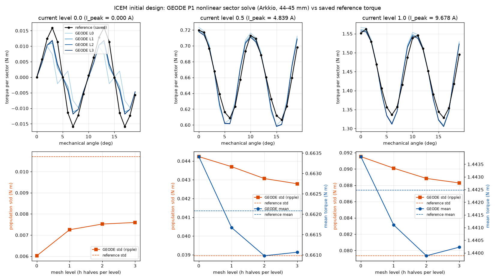

# ICEM initial design: forward torque reproduction

Motor paper M2, issue #1168. This is the reproduction gate of
`pilot_protocol.json` stage 1. GEODE solves the ICEM reference motor's
**initial** design and compares its torque waveforms with the saved
reference arrays in `../reference_data.json`. The study uses four mesh
levels (L0 to L3), three current levels (0, 0.5 and 1 of the saved peak
current) and 20 mechanical angles. The numbers below were measured on the
tree after #1167 (orientation-independent magnetization load). Nothing was
tuned toward the reference.

**Verdict.**
- **Mean torque is reproduced.** At L3 it is 0.15% low at half current and
  0.16% low at full current.
- **Ripple is not reproduced.** Ripple is the reference's optimization
  objective, the population standard deviation over angle.
  - Under load, GEODE's ripple is 10% higher (half current) and 11% higher
    (full current) than the reference.
  - Cogging ripple is 29% lower.
- **The reference falls outside the L3 discretization band for every
  quantity.** For the mean it misses by 0.05% and 0.07%. For the ripple it
  misses by 8% to 27% of the reference value. The ripple bands are about 1%
  wide, so this is a clear miss.
- **Our modelling choices are ruled out.** We measured the M27 low-field law,
  the Newton tolerance, the winding area and the torque estimator. None of
  them moves the torque by more than 4e-4 N m.
- **The current phase convention is also ruled out.** The cogging case has
  no current, and its waveform shape still disagrees.
- **Most likely cause, not proven: the coupling model.** The reference
  couples rotor and stator through 16 air-gap harmonics (n = 3, 9, ..., 45).
  GEODE uses a conforming band. Details are in "What the evidence points
  to" below.



## Setup

Every item is pinned in `crates/geode-core/tests/common/icem_forward.rs`.
Each item cites the field of `../conventions.json` it comes from.

| item | value | source |
|---|---|---|
| mesh | `../geometry/meshes/icem_initial_sector_L{0..3}.msh` (L1 to L3 regenerated with the `geometry/README.md` command; L0 is byte-identical to the pinned file) | #1162 |
| sector | 60 deg, antiperiodic (`A_high = -A_low`), radial edges 111/112 (rotor) and 113/114 (stator) | `geometry.modeled_sector_degrees`, `boundaries.*_antiperiodic_pair` |
| rotation | conforming sliding band on r_c = 44.5 mm (tags 121/122), N = 120 * 2^L, so 1 deg = N/60 steps; rotor nodes and the magnetization rotate counter-clockwise for positive beta | #1161; sign checked against `setRotationAngle`, below |
| Dirichlet | A_z = 0 on 101 (shaft) and 102 (outer stator) | `boundaries.rotor_dirichlet`, `stator_dirichlet` |
| iron | `TabulatedBhLaw::from_hb` on the 47 M27 points, tags 1 (including the bridges, patches 2 and 5) and 6 | `materials.iron`, #1160 |
| air, gap, slot air, copper | mu_r = 1 | `materials.air_and_copper_relative_permeability` |
| magnet | linear, mu_r = 1.05, M = Hc (cos pi/2, sin pi/2), Hc = Br/(mu0 mu_r) = 1.061033e6 A/m, fixed in the rotor frame | `materials.magnet_*` |
| currents | I_q = I_peak sin(phi0 + 3 beta + offset_q), offsets U 0, V -2pi/3, W +2pi/3, phi0 = 0, I_peak = 9.677657374172274 A times 0, 0.5, 1 | `excitation.*` |
| current density | J_g = I_q * 12 * sign_g / area_g, using each group's own mesh area (cross-check with the exact area below) | `excitation.current_density_rule` |
| angles | 0 to 19 deg in 1 deg steps; each current starts from the linear solution at 0 deg, and each later angle warm-starts from the previous one | `torque.saved_profile_grid_mechanical_degrees` |
| torque | Arkkio over tags 4 + 5 (44.0 to 45.0 mm), times L = 0.1 m, per modelled sector, SymMult = 1 | `torque.reported_units` |
| Newton | consistent tangent, energy line search, rel_tol 1e-8 (default) | #1159 |

### Conventions resolved from the source

These were resolved by reading the pinned upstream code, not by fitting.

**Magnet source.** The reference's `addRemanenceRotor` adds the load
`Hc * op_gradv_n_bot(alpha)`, which is `Hc ∫ ∇v · (-sin alpha, cos alpha)`.
Here Hc = Br / getMuLinear and getMuLinear = Mur * Mu0.

GEODE's `with_magnetization` adds `∫ M · (∇φ)^⊥`. For M = Hc (cos alpha,
sin alpha) this is the same integrand.

GEODE's constitutive law is H = ν B - M. So M = Hc gives the remanence
B(H = 0) = Br exactly. The scaling of
`radial_magnetization_source_from_remanence`, M = Br/mu0, would instead give
mu_r Br = 1.47 T, which is 5% too strong. `tests/motor_icem_forward.rs` pins
this.

**Rotation sign.** In `setRotationAngle`, column sin(n psi) of the rotated
stator coupling matrix is B_sin cos(n beta) - B_cos sin(n beta). That is
sin(n(phi - beta)), so psi = phi - beta: the rotor turns **counter-clockwise**
for positive beta. GEODE's sliding band also rotates counter-clockwise for
positive k.

**Torque sign.** The reference's saddle system is K u + B λ = f, Bᵀu = 0,
with B = [-B_rt; B_st R(beta)].

- The minimum of the Lagrangian is the negative coenergy.
- Its derivative with respect to beta is u_stᵀ B_st R'(beta) λ.
- So `calcTorqueCoupling` = -u_stᵀ B_st R' λ L = +dW'/dbeta.

That is the torque on the rotor in the +beta (counter-clockwise) direction,
the same sign as Arkkio's (L/mu0) ∫ r B_r B_θ.

The agreement of the signs was checked after the derivation, not used to
choose it. Both give positive (motoring) mean torque.

**Current phase.** `setCurrent(I, angle)` uses
sin(Phase0 + PolePairs * angleRad + offset), with the same angle as the
rotation and Phase0 = deg2rad(operatingAngle) = 0.

**Areas.** At the saved peak current, group 1 with the exact NURBS area gives
3.2000000070e6 A/m², the optimizer's Jinit. The test pins this.

## Results

The tables are generated by `analyze.py` into `tables.md`. Every torque,
Newton count, status and wall time is in `torque_table.csv`, and the full
numbers are in `summary.json`. Units are N m per modelled sector.

### Mean and ripple vs the reference, 20 angles

| current | level | mean | ref mean | d mean % | std | ref std | d std % | max abs dT |
|---|---|---|---|---|---|---|---|---|
| 0 | L0 | 0.00000 | 0.00010 | n/a | 0.00602 | 0.01071 | -43.8 | 0.01351 |
| 0 | L1 | 0.00000 | 0.00010 | n/a | 0.00725 | 0.01071 | -32.3 | 0.00842 |
| 0 | L2 | -0.00003 | 0.00010 | n/a | 0.00752 | 0.01071 | -29.8 | 0.00741 |
| 0 | L3 | 0.00001 | 0.00010 | n/a | 0.00760 | 0.01071 | -29.1 | 0.00715 |
| 0.5 | L0 | 0.66341 | 0.66208 | +0.20 | 0.04423 | 0.03895 | +13.6 | 0.01744 |
| 0.5 | L1 | 0.66167 | 0.66208 | -0.06 | 0.04370 | 0.03895 | +12.2 | 0.01537 |
| 0.5 | L2 | 0.66098 | 0.66208 | -0.17 | 0.04306 | 0.03895 | +10.6 | 0.01458 |
| 0.5 | L3 | 0.66106 | 0.66208 | -0.15 | 0.04279 | 0.03895 | +9.9 | 0.01471 |
| 1 | L0 | 1.44380 | 1.44248 | +0.09 | 0.09152 | 0.07935 | +15.3 | 0.03385 |
| 1 | L1 | 1.44111 | 1.44248 | -0.10 | 0.09010 | 0.07935 | +13.5 | 0.02962 |
| 1 | L2 | 1.43989 | 1.44248 | -0.18 | 0.08884 | 0.07935 | +12.0 | 0.02721 |
| 1 | L3 | 1.44023 | 1.44248 | -0.16 | 0.08829 | 0.07935 | +11.3 | 0.02719 |

On the reference's 10-angle optimization grid (0 to 18 deg in 2 deg steps,
compared with the stored history values), L3 gives the following:

| current | mean | ref | d mean | std | ref | d std |
|---|---|---|---|---|---|---|
| 0 | 0.00001 | 0.00010 | -0.00009 | 0.00708 | 0.01069 | -33.8% |
| 0.5 | 0.66109 | 0.66209 | -0.15% | 0.04267 | 0.03897 | +9.5% |
| 1 | 1.44031 | 1.44249 | -0.15% | 0.08783 | 0.07934 | +10.7% |

### Convergence in h and the L3 discretization band

Each level halves h.

**Band method.** The band is L3 ± max(|d12|, |d23|), the larger of the last
two increments.
- Under a monotone sequence with rate p ≥ 1, the last increment alone would
  bound the remaining error.
- The mean-torque sequences change sign between d12 and d23. They are not
  yet in the asymptotic range, so the wider band is used.

The Richardson value uses p from L1, L2 and L3. It is a point estimate, not
a converged value.

| current | quantity | L0 | L1 | L2 | L3 | p(0,1,2) | p(1,2,3) | L3 band | Richardson | reference | ref outside band by |
|---|---|---|---|---|---|---|---|---|---|---|---|
| 0 | std | 0.00602 | 0.00725 | 0.00752 | 0.00760 | 2.19 | 1.87 | [0.00733, 0.00786] | 0.00762 | 0.01071 | +0.00285 (27% of ref) |
| 0.5 | mean | 0.66341 | 0.66167 | 0.66098 | 0.66106 | 1.33 | 3.00 | [0.66037, 0.66176] | 0.66108 | 0.66208 | +0.00032 (0.05%) |
| 0.5 | std | 0.04423 | 0.04370 | 0.04306 | 0.04279 | -0.24 | 1.20 | [0.04215, 0.04342] | 0.04258 | 0.03895 | -0.00321 (8.2%) |
| 1 | mean | 1.44380 | 1.44111 | 1.43989 | 1.44023 | 1.15 | 1.84 | [1.43901, 1.44144] | 1.44036 | 1.44248 | +0.00104 (0.07%) |
| 1 | std | 0.09152 | 0.09010 | 0.08884 | 0.08829 | 0.17 | 1.20 | [0.08703, 0.08955] | 0.08786 | 0.07935 | -0.00768 (9.7%) |

**Pointwise waveform.** The largest change between levels falls each time:
- zero current: 0.0052, then 0.0010, then 0.00028 (rates 2.3 and 1.9);
- half current: 0.0052, then 0.0017, then 0.00056 (rates 1.6 and 1.6);
- full current: 0.0063, then 0.0032, then 0.0012 (rates 1.0 and 1.5).

The largest |L3 - ref| is 0.0072, 0.0147 and 0.0272 N m at the three
currents. The reference lies outside the pointwise L3 band at 18, 18 and 17
of the 20 angles.

### Sensitivity to modelling choices

Each variant is compared with the baseline at the same level and with the
same 20 angles.

| variant | level | max abs dT (N m) | d mean | d std |
|---|---|---|---|---|
| M27 low field = reference pchip first segment with the 426 m/H clamp (`clamp426`; m0 = 426.0434, ν(B ≤ 1e-5 T) = 426.0321 m/H vs GEODE ν(0) = 397.66) | L2, L3 | 2.1e-6 | ≤ 1.9e-7 | ≤ 2.5e-7 |
| Newton rel_tol 1e-12 vs 1e-8 | L2 (all), L3 (full current) | 7.3e-8 | ≤ 9e-9 | ≤ 8e-9 |
| J from the exact NURBS group areas vs mesh areas | L2 | 3.9e-4 | -3.5e-4 (-0.024%) | -2.0e-5 |
| Arkkio half-bands (inner 44.0 to 44.5 mm or outer 44.5 to 45.0 mm) vs the full band | L3 | 7e-5 | ≤ 1e-5 | |
| Maxwell stress on one circle (r = 44.10, 44.25, 44.75, 44.90 mm) vs Arkkio | L3 | 0.0023 to 0.025 | -0.0017 to +0.0013 | |

The single-circle Maxwell estimate does not settle with refinement. At full
current its largest difference from Arkkio is 0.04 at L0, 0.006 at L1, 0.04
to 0.06 at L2 and 0.002 to 0.025 at L3. This is the known pointwise noise of
B_r B_θ on P1 triangles. Arkkio is the production estimator.

### Cogging symmetry

With 36 slots and 6 poles, the zero-current torque has a 10 deg period and is
odd about 0 deg. The residuals below are therefore pure numerical error.

| solution | max abs T(b) - T(b+10) | max abs T(b) + T(10-b) |
|---|---|---|
| reference | 5.5e-4 | 5.4e-4 |
| GEODE L3 | 2.5e-5 | 4.7e-5 |

### Cost

The runs were sequential on this machine (Apple Silicon, release build). Each
level ran 60 solves, and every solve converged on the tolerance test (no
round-off-floor acceptances).

| level | nodes | Newton its (first solve / warm) | wall per solve (median / first) | total |
|---|---|---|---|---|
| L0 | 3,153 | 8 to 12 / 2 to 3 | 0.09 s / 0.3 s | 6 s |
| L1 | 9,937 | 9 to 12 / 2 to 3 | 0.54 s / 1.9 s | 36 s |
| L2 | 36,083 | 9 to 13 / 2 to 3 | 3.3 s / 13 s | 223 s |
| L3 | 139,268 | 12 to 14 / 2 to 3 | 16 s / 68 s | 1076 s |

The whole study (`run_all.sh`, 520 solves including the sensitivity runs)
took 3500 s of solve time. No cloud was used.

## What the evidence points to

The question is why the reference is outside the band.

- **P1 accuracy: unlikely.**
  - The ripple converges monotonically at p ≈ 1.2 under load and p ≈ 1.9
    for cogging.
  - The Richardson values (0.0879, 0.0426, 0.0076) move away from the
    reference, or barely move.
  - Closing the full-load gap of 0.0089 would need the remaining error to be
    16 times the last increment.
- **Material endpoints: ruled out at the low field.** The reference's 426 m/H
  low-field law changes the torque by about 2e-6 N m.
  - The 2.25 to 2.30 T segment, where H differs by up to 2.2e-4 relative and
    dH/dB jumps by 0.75% in the reference, was not tested.
  - Above 2.30 T both laws use the same 1/mu0 tail. The bridges reach 3.14 T
    at L3, where the laws are identical.
- **Solver and estimator settings: ruled out.** The Newton tolerance, the
  winding area and the Arkkio band all change the torque by at most 4e-4.
- **Excitation conventions: unlikely.** The cogging case (zero current, so no
  phase, area or current convention involved) disagrees in shape.
  - The reference peaks at 3 deg (0.0159) and has 0.0114 at 4 deg.
  - GEODE L3 peaks at 3 deg (0.0119) and has 0.0043 at 4 deg.
  - The 4 deg value has converged (increments 0.0051, 0.0010, 0.0003).
- **Reference self-consistency.** Its cogging symmetry residual (5.5e-4) is
  11 to 22 times GEODE L3's, but it is 13 times smaller than the cogging
  disagreement.
- **Coupling model: most likely, not proven.**
  - **How the reference couples.** It connects rotor and stator only through
    the 16 harmonics 3, 9, ..., 45 of the coupling circle
    (`setCouplingHarmonics`). Higher harmonics of the trace are not
    transmitted, and the flux of those modes is zero on each side.
  - **How GEODE couples.** It enforces nodal continuity, which carries
    harmonics up to about N.
  - **The diagnostic.** We filtered GEODE's L3 air-gap field to n ≤ 45 after
    the solve; this is not a truncated-coupling solve. The filtered field
    gives this:
    - Under load, mean and ripple move by at most 0.3% and 0.6%.
    - Cogging ripple jumps from 0.0075 to 0.0184.
  - **What that shows.** GEODE's cogging is a cancellation between harmonic
    pairs below and above n = 45, so a model that cuts the interface at 45 is
    expected to change it strongly.
  - **What it does not show.** Filtering after the solve does not reproduce
    the reference either, under load or at zero current. The field of a
    truncated-coupling solve redistributes, so the measurement indicates
    the cause without proving it.
  - **The test that would settle it.** Solve in GEODE with a
    harmonic-truncated coupling (a follow-up).

## Reproduce

From the repository root, after regenerating L1 to L3 with the
`../geometry/README.md` command:

```sh
CARGO_TARGET_DIR=<private dir> benchmarks/motor_reference/forward/run_all.sh
```

This runs the 9 runs above in sequence, writes `runs/*.json` and
`logs/*.log`, and calls `analyze.py`. A single run looks like this:

```sh
cargo run -p geode-core --release --example icem_initial_torque -- --level 1 --spectrum
```

`crates/geode-core/tests/motor_icem_forward.rs` is the CI-fast regression. It
checks:
- L0 at full current, 0 and 1 deg, against the committed torques here;
- the winding table and the Jinit cross-check;
- the Hc mapping;
- the consistency of the `clamp426` law.

| file | content |
|---|---|
| `runs/L{level}_{law}_{tol}_{area}.json` | raw records: torques by every estimator, Newton iterations, status, residual, wall time per solve |
| `logs/*.log` | the console output of each run, and `analyze.log` |
| `torque_table.csv` | every torque, one row per (run, current, angle), with the reference value |
| `summary.json`, `tables.md` | all comparison, convergence, sensitivity, harmonic and cost tables |
| `icem_initial_torque.png` | the figure |
| `analyze.py`, `run_all.sh` | analysis and driver |
