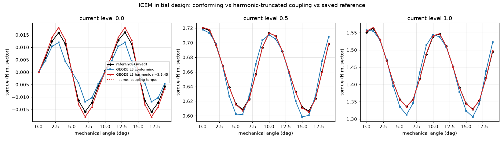

# ICEM initial design: harmonic-truncated rotor-stator coupling

Motor paper M2, issue #1170, a follow-up to the forward reproduction in
[`../forward/`](../forward/README.md) (#1168). That study reproduced the
reference's mean torque to 0.15-0.16% at L3 but not its ripple: load ripple
was 10-11% high and cogging ripple 29% low, with the reference outside the
L3 band. The leading hypothesis was the coupling model. The reference joins
rotor and stator only through 8 harmonic orders n = 3:6:45 (16 sine/cosine
coupling modes); GEODE's conforming sliding band carries every harmonic the
mesh resolves.

This study solves GEODE with the reference's coupling model and measures
the result. Nothing was tuned toward the reference: the orders are the
reference's, and every other input is the #1168 set-up unchanged.

**Verdict (measured).**
- **The load ripple gap is the coupling model.** With n = 3:6:45, the L3
  ripple is +1.7% (half current) and +1.3% (full current) from the
  reference, against +9.9% and +11.3% with the conforming band. At full
  current the reference std lies inside the L3 band. At half current it
  lies 5e-5 N m (0.1% of its value) outside the band edge. The pointwise
  full-current gap falls from 0.027 to 0.0034 N m.
- **The mean torque stays reproduced.** It is within 0.05% of the reference
  at L3, inside the band for both currents.
- **The cogging shape is reproduced, its amplitude is not.** The truncated
  coupling moves cogging ripple from -29% to +12.9% (0.01209 against
  0.01071 N m). The waveform shape now matches (peak at 3 deg, 0.0130 at
  4 deg against the reference's 0.0114), and the L3 cogging waveform is
  close to a uniform 1.13 times the reference. The reference lies outside
  the L3 band by 11% of its own value.
- **The reference's free coupling-circle ends do not explain the rest.**
  The reference leaves the coupling DOFs out of its antiperiodic pairs. The
  same treatment in GEODE changes the L3 torque by at most 5e-5 N m.
- **Remaining unexcluded cause for the cogging amplitude: the reference's
  own discretization.** It uses degree-2 IGA with 3x3 subdivisions per
  patch, and `../conventions.json` records that its saved output is not a
  converged reference. Our own h45 cogging std rises with refinement
  (0.0101, 0.0119, 0.0121, 0.0121 from L0 to L3), so a coarse
  discretization of this model can sit below the refined value; the
  reference is 11% below ours. That points the same way but does not
  bound the reference's error. The reference rerun at finer subdivisions
  (Part B of #1170) was skipped: Octave is not installed here.
- **Update (#1189): the reference's discretization accounts for the cogging
  gap.** Rerun under Octave with finer subdivisions per patch, the
  reference's cogging std is 0.01071, 0.01220, 0.01212 and 0.01208 N m at
  3x3, 6x6, 12x12 and 24x24, against 0.01209 here at L3. See
  [`../reference_refinement/`](../reference_refinement/README.md).



## Method

`CouplingMode::Harmonic(orders)` in
`crates/geode-core/src/assembly/magnetostatic_sector.rs`:

- The mesh already has separate coupling-node sets on r_c = 44.5 mm: tag 121
  (rotor) and tag 122 (stator), N + 1 nodes each, with nothing to split
  (`tests/motor_icem_harmonic.rs` checks this). No remeshing was needed.
- The two sides keep their own coupling nodes. They are joined only by the
  constraints `∫ A_stator e r_c dθ - ∫ A_rotor e r_c dθ = 0` for
  e = sin nθ, cos nθ over the chosen orders. These are the moments of the
  reference's `generateCouplingMatrices` (`op_fs_v` of sin/cos of the polar
  angle on the coupling boundary), re-derived for P1 traces. The hat
  function at θ_i has the exact moment `r_c Δ sinc²(nΔ/2) e^{inθ_i}`.
- Rotor hats sit at their rotated lab angles, so the rotation is in the
  constraint, as the reference's `R(β)` block is. Orders must have the sector
  symmetry, which makes the product of trace and test function 60-degree
  periodic.
- `NonlinearMagnetostaticSystem::solve_constrained` (in
  `assembly/magnetostatic_nonlinear.rs`) runs the consistent-tangent Newton
  on the saddle system `[[K, C], [Cᵀ, 0]]`, `C = Pᵀ G`. Each step factors K
  once, solves it for the residual and the m constraint columns, and
  eliminates the multipliers through the m x m Schur complement. The energy
  line search applies unchanged because every step stays feasible. The
  tolerance is unchanged as well (rel_tol 1e-8 on the projected residual
  R + Cλ).
- **Coupling torque.** The rotor energy is invariant under the rigid
  rotation, so the envelope theorem gives `T = -λᵀ ∂(Gᵀ A)/∂β`, with ∂/∂β
  acting on the rotor hat centres. This is the reference's
  `calcTorqueCoupling` construction, re-derived here; the upstream code was
  read as data only. It is reported next to Arkkio.
- `CouplingMode::HarmonicFreeEnds(orders)` also leaves the end nodes of each
  side's coupling trace out of the radial-edge pairs, as the reference does
  (`setAntiPeriodicBoundaries` removes `CouplingDOFS` from the antiperiodic
  sets). Those nodes then carry half hats.

### Validation

`crates/geode-core/tests/magnetostatic_sector_harmonic.rs` covers the
synthetic slotless machine (output in `logs/test_sector_harmonic.log`), and
`tests/motor_icem_harmonic.rs` covers ICEM L0 (`logs/test_motor_icem_harmonic.log`).

| check | result |
|---|---|
| every order below Nyquist (n = 3:6:3N-3, N constraints) vs the conforming band, synthetic, 4 steps including wrap-around and k < 0 | ‖dA‖/‖A‖ ≤ 1.1e-15 |
| same, ICEM L0 and L1, 60 solves each (table below) | max abs dT 4.1e-9 and 1.2e-9 N m |
| truncation ladder n_max = 3, 9, ..., 285 vs conforming (synthetic) | A_z error falls to round-off (6e-16 to 8e-16) from n_max = 93 on |
| ICEM order ladder at L1, L2 (table below) | n_max = 189 is within 1e-4 N m of the conforming band |
| FD check of the saddle Jacobian at a saturated off-equilibrium state | 1.8e-9 relative at h = 1e-6 (O(h²) above) |
| coupling torque vs the central difference of the constrained minimum energy, tied ends, N = 48 / 96 | 9e-4 / 2.2e-4 relative (O(Δ²)) |
| same, free ends, N = 48 / 96 | 1.2e-3 and 3.3e-4 / 6.0e-4 and 1.1e-5 (k = 3 and 11) |
| free-end half-hat moments vs tied full hats on antiperiodic traces | ≤ 3.3e-16 relative |

Under the harmonic coupling A_z is discontinuous across r_c in the modes
that are not transmitted, so the inner and outer half-band Arkkio estimates
differ. They also differ from the coupling torque. At L3 all three agree
with the full-band Arkkio to within 9e-5 N m.

## Results

All numbers are generated by `analyze.py` into `tables.md`
(`summary.json`, `torque_table.csv`). The conforming-band numbers are the
committed #1168 records in `../forward/runs/`. The conforming code path is
unchanged here: an L0 rerun reproduced all 60 committed Arkkio torques
bit for bit.

### Conforming vs truncated (n = 3:6:45, tied ends) vs reference, L0-L3

Arkkio over 44.0 to 45.0 mm, N m per modelled sector. Std is the population
std over 20 angles, the reference's ripple metric.

| current | level | conforming mean | conforming std | truncated mean | truncated std | ref mean | ref std | trunc d std % | conf d std % |
|---|---|---|---|---|---|---|---|---|---|
| 0 | L0 | 0.00000 | 0.00602 | -0.00000 | 0.01014 | 0.00010 | 0.01071 | -5.3 | -43.8 |
| 0 | L1 | 0.00000 | 0.00725 | -0.00000 | 0.01187 | 0.00010 | 0.01071 | +10.9 | -32.3 |
| 0 | L2 | -0.00003 | 0.00752 | -0.00003 | 0.01206 | 0.00010 | 0.01071 | +12.6 | -29.8 |
| 0 | L3 | 0.00001 | 0.00760 | -0.00000 | 0.01209 | 0.00010 | 0.01071 | +12.9 | -29.1 |
| 0.5 | L0 | 0.66341 | 0.04423 | 0.66461 | 0.04090 | 0.66208 | 0.03895 | +5.0 | +13.6 |
| 0.5 | L1 | 0.66167 | 0.04370 | 0.66256 | 0.04051 | 0.66208 | 0.03895 | +4.0 | +12.2 |
| 0.5 | L2 | 0.66098 | 0.04306 | 0.66199 | 0.03990 | 0.66208 | 0.03895 | +2.4 | +10.6 |
| 0.5 | L3 | 0.66106 | 0.04279 | 0.66206 | 0.03961 | 0.66208 | 0.03895 | +1.7 | +9.9 |
| 1 | L0 | 1.44380 | 0.09152 | 1.44722 | 0.08342 | 1.44248 | 0.07935 | +5.1 | +15.3 |
| 1 | L1 | 1.44111 | 0.09010 | 1.44383 | 0.08212 | 1.44248 | 0.07935 | +3.5 | +13.5 |
| 1 | L2 | 1.43989 | 0.08884 | 1.44289 | 0.08091 | 1.44248 | 0.07935 | +2.0 | +12.0 |
| 1 | L3 | 1.44023 | 0.08829 | 1.44322 | 0.08036 | 1.44248 | 0.07935 | +1.3 | +11.3 |

The coupling-torque estimator gives the same picture. At L3 its means are
0.66210 and 1.44326 and its stds are 0.01208, 0.03961 and 0.08035
(`tables.md`).

### L3 band of the truncated solve

The band is L3 ± max(|d12|, |d23|), the same rule as `../forward`.

| current | quantity | L3 | L3 band | reference | reference in band? |
|---|---|---|---|---|---|
| 0 | std | 0.01209 | [0.01190, 0.01228] | 0.01071 | no, 0.00119 below (11.1% of ref) |
| 0.5 | mean | 0.66206 | [0.66149, 0.66263] | 0.66208 | yes |
| 0.5 | std | 0.03961 | [0.03899, 0.04023] | 0.03895 | no, 0.00005 below (0.1% of ref) |
| 1 | mean | 1.44322 | [1.44228, 1.44416] | 1.44248 | yes |
| 1 | std | 0.08036 | [0.07914, 0.08157] | 0.07935 | yes |

The largest pointwise gaps |L3 - ref| are 0.0021, 0.0015 and 0.0034 N m
for the truncated coupling, against 0.0072, 0.0147 and 0.0272 N m for the
conforming band. Under load the reference lies outside the pointwise L3 band
at 9 of 20 and 3 of 20 angles, against 18 and 17 with the conforming band.
For cogging it is still 18 of 20. The cogging waveforms are compared angle by
angle in `tables.md` ("L3 waveforms").

### Order ladder at a fixed level

Orders n = 3:6:n_max; "inf" is the conforming band.

| level | n_max | constraints | cogging std | half std | full std |
|---|---|---|---|---|---|
| L1 | 21 | 8 | 0.01751 | 0.02020 | 0.02352 |
| L1 | 45 | 16 | 0.01187 | 0.04051 | 0.08212 |
| L1 | 93 | 32 | 0.00725 | 0.04328 | 0.08919 |
| L1 | 189 | 64 | 0.00725 | 0.04368 | 0.09008 |
| L1 | 381 | 128 | 0.00725 | 0.04370 | 0.09010 |
| L1 | 717 (all) | 240 | 0.00725 | 0.04370 | 0.09010 |
| L1 | inf | - | 0.00725 | 0.04370 | 0.09010 |
| L2 | 45 | 16 | 0.01206 | 0.03990 | 0.08091 |
| L2 | 93 | 32 | 0.00757 | 0.04264 | 0.08792 |
| L2 | 189 | 64 | 0.00752 | 0.04305 | 0.08882 |
| L2 | inf | - | 0.00752 | 0.04306 | 0.08884 |
| L3 | 45 | 16 | 0.01209 | 0.03961 | 0.08036 |
| L3 | 93 | 32 | 0.00766 | 0.04236 | 0.08735 |
| L3 | inf | - | 0.00760 | 0.04279 | 0.08829 |
| reference | 45 | 16 | 0.01071 | 0.03895 | 0.07935 |

The ripple depends strongly on the cut between 45 and 93, and hardly at all
above 189. Every order below Nyquist reproduces the conforming band to
4e-9 N m (L0) and 1.2e-9 N m (L1). The cut at 45 is therefore a
model-level choice in the reference, not a discretization detail. It
changes the cogging ripple by 59% and the load ripple by 7 to 9% relative to
the converged-in-modes value.

### Free coupling-circle ends (the reference's treatment)

The free ends change the h45 Arkkio torque by at most 0.0019 N m at L0,
0.00095 at L1, 0.00022 at L2 and 5e-5 at L3: a discretization-level effect
that shrinks about 4 times per level. At L3 the free-end ripple is 0.01209,
0.03962 and 0.08036, against 0.01209, 0.03961 and 0.08036 with tied ends. Tables are
in `tables.md`.

### Cost

The runs were sequential on this machine (Apple Silicon, release build). The
free-end batch overlapped with a clippy build, so its wall times are
indicative. Every one of the 1,140 solves converged on the tolerance test.
Under the harmonic coupling with 16 modes, an L3 solve takes 9.0 s median,
against 16 s for the conforming band in #1168. With m constraints each Newton
step adds m extra triangular solves and an O(m² n) Schur complement, so 128
modes at L2 cost 5.4 times as much as 16 modes. Full table:
`tables.md` ("Cost").

## Reproduce

From the repository root, after regenerating L1 to L3 with the
`../geometry/README.md` command:

```sh
CARGO_TARGET_DIR=<private dir> benchmarks/motor_reference/forward_harmonic/run_all.sh
```

The runs were made in two batches: `logs/run_all.log`, and
`logs/run_free_ends.log` for the four `--ends free` runs, which were added to
`run_all.sh` afterwards. A single run looks like this:

```sh
cargo run -p geode-core --release --example icem_initial_torque -- \
    --level 1 --coupling harmonic:3:6:45 [--ends free]
```

| file | content |
|---|---|
| `runs/L{level}_h{n_max}[f].json`, `runs/L{level}_hall.json` | raw records: Arkkio (full and half bands), coupling torque, constraint violation, Newton iterations, status, residual, wall time per solve |
| `logs/*.log` | console output of each run, `analyze.log`, the two batch logs, and the `--nocapture` output of the two test files |
| `torque_table.csv`, `summary.json`, `tables.md` | all tables |
| `icem_harmonic_torque.png` | the figure |
| `analyze.py`, `run_all.sh` | analysis and driver |
