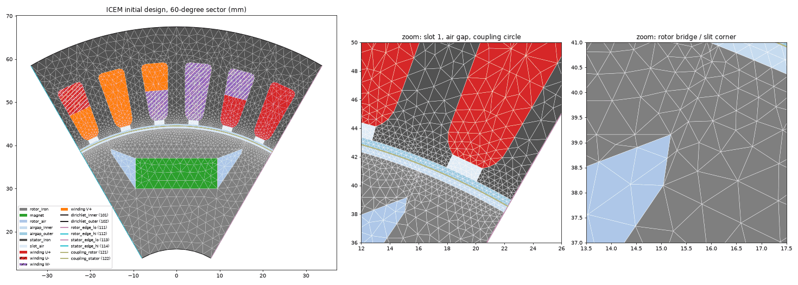

# ICEM initial design: tagged 60-degree sector mesh family

Motor paper M2, issue #1162. This directory converts the pinned GeoPDEs NURBS
exports of the ICEM reference motor's **initial** design
(`results/plots/final/RotorOpt0.txt`, `StatorOpt0.txt` at upstream commit
`b145aaf4`, hashes in `../sources.json`) into tagged gmsh meshes that GEODE
loads with `geode_core::mesh::read_tagged_tri_mesh`. It covers geometry and
mesh only. There is no solve or torque here.

| file | role |
|---|---|
| `geopdes_nurbs.py` | Parser for the GeoPDEs v2.1 multipatch format and exact rational B-spline evaluator (Cox-de Boor), with Green's-theorem areas. Written independently for GEODE; no upstream code is copied. |
| `build_sector_mesh.py` | Hash-checks the exports, builds the exact OCC model in gmsh, tags it and meshes a family. Writes `meshes/*.msh`, a per-level `meshes/*_report.json` and `exact_areas.json`. |
| `plot_sector_mesh.py` | Plots the tagged mesh (`icem_initial_sector_L0.png`). |
| `exact_areas.json` | Exact NURBS region areas, winding-group areas and current densities. |
| `meshes/icem_initial_sector_L0.msh` | The pinned coarse mesh (322 KB) used by `crates/geode-core/tests/motor_reference_mesh.rs`. L1 to L3 are gitignored. Regenerate them with the command below. |
| `build_sector_mesh.log` | Log of the run that produced the committed outputs. |

## Reproduce

From the repository root (gmsh 4.15.2 Python wheel; the Homebrew CLI here is also 4.15.2):

```sh
uv run --with scipy==1.18.1 python -I benchmarks/motor_reference/extract_reference.py --fetch --check
uv run --with numpy==2.5.4 --with gmsh==4.15.2 python -I \
    benchmarks/motor_reference/geometry/build_sector_mesh.py --levels 0 1 2 3 \
    --out benchmarks/motor_reference/geometry/meshes \
    --areas-out benchmarks/motor_reference/geometry/exact_areas.json
uv run --with numpy==2.5.4 --with gmsh==4.15.2 --with matplotlib==3.11.2 --with pillow==11.3.0 python -I \
    benchmarks/motor_reference/geometry/plot_sector_mesh.py \
    benchmarks/motor_reference/geometry/meshes/icem_initial_sector_L0.msh \
    benchmarks/motor_reference/geometry/icem_initial_sector_L0.png
```

Meshing runs single-threaded with a fixed seed. The L0 file is byte-identical
across runs (sha256 `4d0124a292ffb657...`, recorded in its report). The
generator stops with `FAIL:` if a hash, a patch partition, a shared side, a
loop, a node count or the gap/overlap check fails.



## Conventions

- Units are meters. The geometry is unscaled (ScaleR = 1). At rotor angle 0
  the sector spans theta in [60, 120] degrees, as in `../conventions.json`.
  Upstream generators fix the magnet direction (+y in the rotor frame) and
  the winding layout. This directory does not use them.
- **Rotor and stator are disjoint in the mesh.** The coupling circle
  r_c = 44.5 mm carries two physical lines: `coupling_rotor` (121), which
  bounds `airgap_inner`, and `coupling_stator` (122), which bounds
  `airgap_outer`. Each has **N + 1** nodes, including both sector-edge
  endpoints, at theta_j = 60 deg + j * 60 deg / N, j = 0..N. At rotor angle 0,
  rotor node j and stator node j are distinct nodes at the same position
  (max separation 0). The two endpoints are antiperiodic images of each other,
  so N nodes per side are independent. N = 120 * 2^level, so every level is
  conforming at 1 degree steps (k = N/60 steps per degree) and at 2 degree
  steps.
- **Antiperiodic radial edges.** `*_edge_lo` lies at theta = 60 deg (master)
  and `*_edge_hi` at theta = 120 deg (slave). The rotor pair (111/112) and the
  stator pair (113/114) are meshed with gmsh `setPeriodic`, so the slave =
  R(+60 deg) * master, node for node, with a max mismatch of 7e-16 m. For
  6 poles over a 60-degree sector, A_z(slave) = -A_z(master). The rotor edges
  rotate with the rotor.
- Each region uses one physical tag. **Triangle orientation in the `.msh` is
  mixed**, because gmsh follows each surface's parametrisation and the
  patches come in both orientations. `read_tagged_tri_mesh` **normalises it on
  load**: it swaps two nodes of every clockwise triangle, so every GEODE
  consumer gets counter-clockwise triangles (signed area > 0, as the
  magnetostatic assemblers assert). Tags stay aligned, and the count is
  reported in `TaggedTriMesh::reoriented_triangles`. Any other reader of the
  `.msh` must orient triangles itself. Clockwise triangles as written (found
  in the review of PR #1164): L0 3051 / 5938, L1 10459 / 19163,
  L2 38841 / 70757, L3 151876 / 275736. By region at L0:

  | region | clockwise / total |
  |---|---|
  | rotor_iron | 1159 / 1671 |
  | magnet | 0 / 93 |
  | rotor_air | 32 / 64 |
  | airgap_inner | 0 / 484 |
  | airgap_outer | 0 / 518 |
  | stator_iron | 1128 / 1932 |
  | slot_air | 246 / 246 |
  | winding groups 1, 4, 5, 6, 9, 11 | 19 / 60 each |
  | winding groups 2, 3, 7, 8, 10, 12 | 62 / 95 each |
- Material assignment uses the upstream generator's default `"nonlinear"`
  patch lists, which the optimization uses: rotor iron = patches
  1,2,3,4,5,6,9,10,11, magnet = 8, rotor air = 7,12, inner gap band = 13..17.
  Each stator slot block of 19 patches (slot k adds 19k) splits as gap band
  1,2,3; iron 4,6,15..19; slot-opening air 5; and winding patches 7..14. The
  winding groups come from `../reference_data.json`.
- The upstream multipatch boundary IDs (`../conventions.json`) match the
  `BOUNDARY` records in the export files. The generator maps them to the
  physical lines below.

## Tag table

| dim | tag | name | contents | upstream source |
|---|---|---|---|---|
| 2 | 1 | `rotor_iron` | rotor iron (M27) | rotor patches 1,2,3,4,5,6,9,10,11 |
| 2 | 2 | `magnet` | permanent magnet, MW x MH | rotor patch 8 |
| 2 | 3 | `rotor_air` | flux-barrier pockets beside the magnet | rotor patches 7,12 |
| 2 | 4 | `airgap_inner` | air gap r = 44.0 to 44.5 mm (one merged surface) | rotor patches 13..17 |
| 2 | 5 | `airgap_outer` | air gap r = 44.5 mm to the stator bore (one merged surface) | stator patches 1,2,3 (+19k) |
| 2 | 6 | `stator_iron` | stator iron (M27) | stator 4,6,15..19 (+19k) |
| 2 | 7 | `slot_air` | slot openings | stator 5 (+19k) |
| 2 | 10+g | `winding_gg_P+-` | winding group g = 1..12 (phase P, sign) | `winding_groups_one_based_stator_patch_ids` |
| 1 | 101 | `dirichlet_inner` | A_z = 0 at the shaft r = 16 mm | rotor boundary 4 |
| 1 | 102 | `dirichlet_outer` | A_z = 0 at the outer stator r = 67.5 mm | stator boundaries 8,12,16,20,24,32 |
| 1 | 111 | `rotor_edge_lo` | rotor radial edge at theta = 60 deg (master) | rotor boundaries 3,1,6 |
| 1 | 112 | `rotor_edge_hi` | rotor radial edge at theta = 120 deg (slave) | rotor boundaries 5,2,11 |
| 1 | 113 | `stator_edge_lo` | stator radial edge at theta = 60 deg (master) | stator boundaries 1,5,6,7 |
| 1 | 114 | `stator_edge_hi` | stator radial edge at theta = 120 deg (slave) | stator boundaries 27,29,30,31 |
| 1 | 121 | `coupling_rotor` | r_c = 44.5 mm, rotor side, N segments | rotor boundaries 7,8,9,10,12 (merged into one arc) |
| 1 | 122 | `coupling_stator` | r_c = 44.5 mm, stator side, N segments | 18 stator coupling boundaries (merged into one arc) |

Winding names: 11 `winding_01_U+`, 12 `winding_02_U+`, 13 `winding_03_U+`,
14 `winding_04_U-`, 15 `winding_05_W-`, 16 `winding_06_W-`, 17 `winding_07_W-`,
18 `winding_08_W-`, 19 `winding_09_V+`, 20 `winding_10_V+`, 21 `winding_11_V+`,
22 `winding_12_V+`.

## Exact areas and measured mismatches

Exact areas use Green's theorem on the exact rational boundary curves, with
16-point Gauss-Legendre per knot span. Three checks are independent of that:
an 8-point rerun, a separate tensor-product quadrature of det J over each
patch, and the same Green's integral evaluated on the gmsh/OCC curves. All
three agree to <= 5e-14, except the gmsh CAD area of the two merged bands,
which agrees to <= 9e-13. That limit comes from the composite quadrature on
the arc. The mesh columns give (polygon |area| - exact) / exact per level, which
falls as O(h^2), about 4x per level. Straight-sided regions are exact on any
mesh.

| region | tag | patches | exact area (mm^2) | Green nq8 vs nq16 | tensor quad vs Green | gmsh CAD vs exact | L0 mesh | L1 | L2 | L3 |
|---|---|---|---|---|---|---|---|---|---|---|
| rotor_iron | 1 | 9 | 702.414508440 | 4.6e-16 | 4.6e-16 | -3.1e-16 | +5.26e-04 | +1.50e-04 | +4.03e-05 | +1.01e-05 |
| magnet | 2 | 1 | 133.000000000 | 0.0e+00 | 2.4e-15 | +8.2e-16 | +2.04e-16 | +4.08e-16 | +4.08e-16 | +4.08e-16 |
| rotor_air | 3 | 2 | 44.231434565 | 1.5e-15 | 1.1e-15 | -2.1e-15 | -1.23e-15 | -9.19e-16 | -1.23e-15 | -1.23e-15 |
| airgap_inner | 4 | 5 | 23.169245820 | 9.8e-15 | 1.3e-15 | +7.5e-13 | -1.12e-05 | -2.35e-06 | -4.70e-07 | -6.27e-08 |
| airgap_outer | 5 | 18 | 23.431045208 | 7.8e-15 | 4.3e-16 | -9.0e-13 | +8.40e-05 | +1.01e-05 | +9.36e-07 | +2.34e-07 |
| stator_iron | 6 | 42 | 906.656431406 | 6.0e-15 | 6.0e-16 | -3.6e-16 | +9.45e-04 | +2.35e-04 | +6.79e-05 | +1.64e-05 |
| slot_air | 7 | 6 | 13.664784615 | 1.9e-15 | 1.2e-15 | -1.1e-15 | +2.75e-04 | +6.87e-05 | +1.72e-05 | +4.30e-06 |
| winding_01_U+ | 11 | 4 | 36.291215073 | 9.5e-15 | 2.2e-15 | -1.7e-15 | -3.94e-03 | -1.00e-03 | -2.93e-04 | -7.21e-05 |
| winding_02_U+ | 12 | 4 | 31.215149045 | 4.6e-14 | 2.2e-16 | +6.5e-16 | -1.75e-03 | -4.97e-04 | -1.32e-04 | -3.34e-05 |
| winding_03_U+ | 13 | 4 | 31.215149045 | 4.4e-14 | 2.2e-16 | -2.2e-16 | -1.75e-03 | -4.97e-04 | -1.32e-04 | -3.34e-05 |
| winding_04_U- | 14 | 4 | 36.291215073 | 5.2e-15 | 1.9e-16 | +3.7e-16 | -3.94e-03 | -1.00e-03 | -2.93e-04 | -7.21e-05 |
| winding_05_W- | 15 | 4 | 36.291215073 | 7.5e-15 | 7.5e-16 | -7.5e-16 | -3.94e-03 | -1.00e-03 | -2.93e-04 | -7.21e-05 |
| winding_06_W- | 16 | 4 | 36.291215073 | 8.6e-15 | 1.3e-15 | -1.9e-16 | -3.94e-03 | -1.00e-03 | -2.93e-04 | -7.21e-05 |
| winding_07_W- | 17 | 4 | 31.215149045 | 4.3e-14 | 8.7e-16 | -4.3e-16 | -1.75e-03 | -4.97e-04 | -1.32e-04 | -3.34e-05 |
| winding_08_W- | 18 | 4 | 31.215149045 | 4.4e-14 | 8.7e-16 | -4.3e-16 | -1.75e-03 | -4.97e-04 | -1.32e-04 | -3.34e-05 |
| winding_09_V+ | 19 | 4 | 36.291215073 | 8.6e-15 | 1.7e-15 | -1.9e-15 | -3.94e-03 | -1.00e-03 | -2.93e-04 | -7.21e-05 |
| winding_10_V+ | 20 | 4 | 31.215149045 | 4.7e-14 | 2.2e-15 | +2.0e-15 | -1.75e-03 | -4.97e-04 | -1.32e-04 | -3.34e-05 |
| winding_11_V+ | 21 | 4 | 36.291215073 | 4.9e-15 | 1.1e-15 | +9.3e-16 | -3.94e-03 | -1.00e-03 | -2.93e-04 | -7.21e-05 |
| winding_12_V+ | 22 | 4 | 31.215149045 | 4.7e-14 | 1.5e-15 | -1.1e-15 | -1.75e-03 | -4.97e-04 | -1.32e-04 | -3.34e-05 |

- Sector total, summed over all 131 patches: relative error 3.7e-15 against
  pi (R_o^2 - R_i^2) / 6 = 2251.6056 mm^2. The rotor and stator sums match their
  annuli to 1.1e-15 and 6.1e-15. Summed region mesh areas: 2.0e-5 (L0) to
  3.4e-8 (L3).
- Magnet (patch 8) = 133.000000 mm^2. Against MW x MH = 19 mm x 7 mm the
  relative error is -6.1e-16.
- Inner band = pi (r_c^2 - 44^2) / 6 to 4e-15, so the rotor surface is the
  exact 44 mm circle.
- **Upstream cross-check.** At the saved initial peak current 9.677657374 A,
  group 1 has J = 12 I / area = 3.2000000070e6 A/m^2. The optimizer set
  Jinit = 3.2e6 A/m^2 in the first group and derived I from its area.
  Agreement is 2.2e-9 relative, which is the upstream area quadrature.

Winding groups for the current-density rule J = I * 12 * sign / area:

| group | name | phase | sign | stator patches | area (mm^2) | J per amp, 12*sign/area (A/m^2) | J at I_peak = 9.6777 A (A/m^2) |
|---|---|---|---|---|---|---|---|
| 1 | winding_01_U+ | U | +1 | [8, 10, 13, 14] | 36.291215073 | 3.306585e+05 | 3.200000e+06 |
| 2 | winding_02_U+ | U | +1 | [7, 9, 11, 12] | 31.215149045 | 3.844287e+05 | 3.720370e+06 |
| 3 | winding_03_U+ | U | +1 | [26, 28, 30, 31] | 31.215149045 | 3.844287e+05 | 3.720370e+06 |
| 4 | winding_04_U- | U | -1 | [103, 105, 108, 109] | 36.291215073 | -3.306585e+05 | -3.200000e+06 |
| 5 | winding_05_W- | W | -1 | [27, 29, 32, 33] | 36.291215073 | -3.306585e+05 | -3.200000e+06 |
| 6 | winding_06_W- | W | -1 | [46, 48, 51, 52] | 36.291215073 | -3.306585e+05 | -3.200000e+06 |
| 7 | winding_07_W- | W | -1 | [45, 47, 49, 50] | 31.215149045 | -3.844287e+05 | -3.720370e+06 |
| 8 | winding_08_W- | W | -1 | [64, 66, 68, 69] | 31.215149045 | -3.844287e+05 | -3.720370e+06 |
| 9 | winding_09_V+ | V | +1 | [65, 67, 70, 71] | 36.291215073 | 3.306585e+05 | 3.200000e+06 |
| 10 | winding_10_V+ | V | +1 | [83, 85, 87, 88] | 31.215149045 | 3.844287e+05 | 3.720370e+06 |
| 11 | winding_11_V+ | V | +1 | [84, 86, 89, 90] | 36.291215073 | 3.306585e+05 | 3.200000e+06 |
| 12 | winding_12_V+ | V | +1 | [102, 104, 106, 107] | 31.215149045 | 3.844287e+05 | 3.720370e+06 |

## Mesh family (quality and conformity)

Quality q = 4 sqrt(3) * area / sum(edge^2), with q = 1 for an equilateral
triangle. Every level passes these checks: each mesh edge lies in at most 2
triangles (no overlap); the set of mesh boundary edges equals the set of
tagged line elements (no gaps or untagged holes); the coupling node count is
N + 1 on each side, on the uniform grid to 6e-15 rad; and the rotated master
edge nodes match the slave nodes to 7e-16 m. The size is r_c * 60deg / N
within 1 mm of r_c and grows to 6x that within 10 mm. Curvature sizing uses
8 * 2^level elements per 2 pi.

| level | N | spacing | edge h min..max (mm) | nodes | triangles | min angle | max angle | q min | q 1% | q mean | tris <20 deg | total mesh area err | AP edge nodes rotor/stator | msh bytes |
|---|---|---|---|---|---|---|---|---|---|---|---|---|---|---|
| L0 | 120 | 0.5 deg | 0.123..2.986 | 3153 | 5938 | 13.20 | 136.8 | 0.351 | 0.566 | 0.944 | 0.0084 | 2.04e-05 | 22/20 | 322111 |
| L1 | 240 | 0.25 deg | 0.106..1.505 | 9937 | 19163 | 13.20 | 139.4 | 0.379 | 0.816 | 0.971 | 0.0002 | 3.89e-06 | 40/35 | 938761 |
| L2 | 480 | 0.125 deg | 0.055..0.803 | 36083 | 70757 | 13.20 | 124.7 | 0.378 | 0.882 | 0.983 | 0.0001 | 7.39e-07 | 78/69 | 3515287 |
| L3 | 960 | 0.0625 deg | 0.026..0.405 | 139268 | 275736 | 13.20 | 126.3 | 0.383 | 0.903 | 0.988 | 0.0000 | 3.44e-08 | 153/135 | 14149864 |

The minimum angle is 13.2 deg at every level. It comes from one triangle at
the corner where the thin rotor iron bridge (patch 2, about 0.5 mm wide) meets
the slit pocket (patch 7), at (+-15.04, 38.14) mm. The family is
self-similar there, so the family is shape-regular, but that corner keeps
the bound. Fewer than 0.01% of triangles are below 20 deg from L1 on.

## Surprises in the export data

1. **Control points are weight-premultiplied.** The coordinate rows hold w*x
   and w*y, not Cartesian points. Read that way, the rotor arc is a circle to
   3.4e-16 m; read as Cartesian it is off by 1.5 mm. The file does not say
   which. `check_coordinate_convention` decides from the data and
   `exact_areas.json` records it.
2. **"Air slit" patches 2 and 5 are iron.** Upstream comments call rotor
   patches 2 and 5 air slits, but the generator's default `"nonlinear"` type
   (which the optimization uses) lists them as iron. Only the `"linear"` type
   makes them air. They are the about 0.5 mm iron bridges, and they set the
   minimum mesh angle.
3. **Rotor and stator coupling breakpoints differ.** On r_c, rotor patch
   sides end at 67.08, 69.95, 110.05 and 112.92 deg (from Theta1/Theta2) and
   stator sides at multiples of 10/3 deg. No uniform 1-degree grid contains
   both sets, so each band is merged into one surface whose r_c edge is a
   single exact arc with N transfinite segments.
4. **Patch orientation is mixed.** 8 of 17 rotor patches and 60 of 114 stator
   patches have negative parametric Jacobian. Any per-patch integral must take
   |det J|.
5. **The two winding-group shapes differ in area**: 36.291 mm^2 for groups
   1,4,5,6,9,11 and 31.215 mm^2 for the rest. With equal turns and current, J
   differs by 16% between groups of the same phase. The torque issue must use
   per-group areas, not a slot average.
6. The upstream boundary IDs in `../conventions.json` match the export's
   `BOUNDARY` records. Shared patch sides from the `INTERFACE` table coincide
   exactly (control-point difference 0), and corners deduplicate with zero
   mismatch.

## Provenance and license

The derived meshes come from upstream data that is GPL-3.0-or-later (see
`../UPSTREAM_LICENSE.txt` and the attribution in `../README.md`). Each
`*_report.json` records the upstream repository, the commit and the sha256 of
both exports. The scripts here are original GEODE code. They read the export
files as data, and they read the upstream generators only for the patch
material lists cited above.
