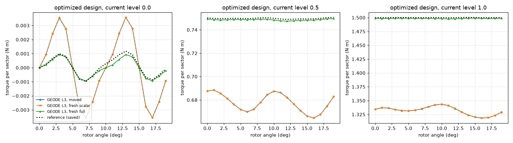

# ICEM design parametrization as fixed-topology node motion

Motor paper M3, part A (issue #1173). This directory gives the reference
optimization's design parametrization as a node-motion map on one mesh
topology, `θ ↦ X(θ)`, with its Jacobian `∂X/∂θ`, and it checks the optimized
design forward. The map is the Rust module
[`geode_core::mesh::icem_parametric`](../../../crates/geode-core/src/mesh/icem_parametric.rs),
so M3b (the shape adjoint) and M5 can call it without Python. There is no
adjoint and no optimization here.

**Verdict (measured).**
- **Boundaries.** At the registered initial parameters the construction
  reproduces every material interface and boundary of the iteration-0 export
  to 7.0e-16 m. At the iteration-120 parameters it misses the export by
  1.403e-3 m on the rotor surface. That gap is the optimizer's free-form
  control-point motion, which no scalar parameter represents (details below).
  The stator differs by at most 1.5e-7 m, and every other interface matches
  to 6e-16 m.
- **Node motion.** The map attaches every interface node of L0 to L3 to its
  curve (7.6e-16 m). The inner gap band and both coupling circles never move,
  exactly, for any parameter. ∂X/∂θ agrees with central differences of X(θ)
  to between 1.3e-13 and 2.3e-9 relative.
- **Validity.** At the optimized design (all 9 parameters at once) the moved
  mesh has no inverted triangle at L0 to L3, with minimum angles of 13.2,
  7.8, 6.9 and 7.1 degrees. One parameter at a time, the fixed topology
  covers the whole box for MH, MW, SW2, SW3 and Sr1. It covers part of it for
  MAG (to 12.3 mm, box 15), SW4 (2.1 to 16.8 mm at L0, 2.3 to 16.2 at L1,
  box 2 to 20) and SD1 (from 117.9 mm at L0 and 119.2 at L1, box from 90).
  Above SW1 = 5.72 mm no slot-top arc tangent to both flanks exists, so that
  part of the box has no geometry, with or without remeshing.
- **Optimized design, forward.** A fresh mesh of the full iteration-120
  export reproduces the saved mean torque to −0.10% (half current −0.15%)
  at L3. Its ripple is 0.00035 N m against the saved 0.00018 N m at full
  current, and 0.00055 against 0.00044 at half current: both are small, and
  the reference lies outside the L3 band. The moved mesh, and a fresh mesh of
  the same 9-parameter geometry, both give −11.2% mean torque (full current) and 17 to 41 times
  the saved load ripple. They differ from each other by at most 2.4e-4 N m at L3,
  falling with h. So the mesh motion error is small. The gap to the reference
  is the free-form pole shaping that the 9 parameters cannot express, not the
  mesh motion.

## Parameters

`reference_data.json` `optimization_parameter_bounds` registers 12
parameters. Nine are geometric. Their values are in the unscaled export
geometry (metres):

| name | meaning (as read from the upstream generators) | box | initial | optimized (iter. 120) |
|---|---|---|---|---|
| MAG | iron depth between the magnet's outer face and the rotor surface, on the pole axis | [6, 15] mm | 7 | 6.1011 |
| MH | magnet height (radial) | [2, 12] mm | 7 | 2.7444 |
| MW | magnet width | [10, 25] mm | 19 | 20.7340 |
| SW1 | stator tooth width (parallel-sided tooth) | [2, 6] mm | 4 | 4.0619 |
| SW2 | slot-opening width | [1, 4] mm | 2.3 | 1.0001 |
| SW3 | slot-opening depth (straight channel below the bore) | [0.5, 1.5] mm | 1 | 0.5004 |
| SW4 | back-iron depth on the slot axis | [2, 20] mm | 8.25 | 5.4336 |
| SD1 | stator outer diameter | [90, 160] mm | 135 | 130.2931 |
| Sr1 | slot-bottom fillet radius | [0.5, 2] mm | 1 | 1.9998 |

The other three are not geometric:

- **LENGTH** (axial length, m): the model is 2-D, so torque is the torque per
  unit length times LENGTH. It is linear in LENGTH. The optimized value is
  0.0800005 m (initial 0.1).
- **OPERATING_ANGLE** (degrees): the electrical current offset φ0 in
  `I_q = I_peak sin(φ0 + 3β + offset_q)` (`../conventions.json`
  `excitation.current_convention`), that is, the load angle. The optimized
  value is −11.646273°.
- **ScaleR** is a uniform similarity scale of the whole cross-section, with the
  current scaled by the same factor. The reference data show this. (1) The
  saved physical currents equal the history's unscaled currents times ScaleR,
  exactly (11.048494105 A × 1.0477172208 = 11.575697538 A, zero difference
  in double precision). (2) `results/PMSM_eval_opt.m` multiplies the x and y
  control coefficients of both exports by ScaleR before solving. (3) The
  optimizer multiplies torque, cost and loss by ScaleR², and its in-loop
  mean torques at iteration 120 match the saved scaled evaluation to 5e-6
  relative. Scaling every coordinate and the current by s leaves B
  unchanged pointwise, nonlinear iron included, and multiplies the torque
  per unit length by s². The optimized design is therefore 4.77% larger in
  every dimension than its export: rotor radius 46.10 mm, coupling radius
  46.62 mm. ScaleR is kept out of the node-motion map, because it would move
  the coupling circle. It is applied as this exact similarity to the
  torques. A scaled-mesh run checks it (results below).

**Defaults warning.** The generators' function defaults differ from the
optimizer's initial values (SW3 0.64 mm and Sr1 1.2 mm in the stator
generator, against 1 mm and 1 mm registered; `geometry_function_defaults`).
`IcemDesign::INITIAL` is the registered set (iteration 0), and that set
reproduces the iteration-0 export to round-off (below).

## Construction

Written for GEODE from the parameter definitions. The upstream GPL
generators were read as data, to learn what each parameter means, and no
code was translated. `sector_curves` returns every material interface and
domain boundary of the sector at θ as named lines and circular arcs:

- **Rotor** (pole axis +x, turned by +90°): the magnet rectangle
  `x ∈ [R_r − MAG − MH, R_r − MAG]`, `|y| ≤ MW/2` (R_r = 44 mm). Each pocket is
  the quadrilateral from the two magnet corners on its side to two fixed
  points (r = R_r − 3 mm at ±0.37558 rad, r = R_r − 2 mm at ±0.37 rad). The
  shaft, rotor surface, radial edges and coupling circle are fixed.
- **Stator slot** (slot k on the axis at 65° + 10° k, tooth centrelines at
  ±5°):
  - The opening is a channel of width SW2 from the bore corners at
    ±asin(SW2/2R_b), R_b = 45 mm, to depth SW3.
  - The flanks are parallel to the tooth centrelines at SW1/2.
  - The slot top is the circular arc through the channel end, tangent to
    both flanks. Its centre `(u, 0)` solves
    `u² cos²α − 2u(x_c − (SW1/2) sin α) + x_c² + (SW2/2)² − (SW1/2)² = 0`
    (larger root), with radius `u sin α − SW1/2`.
  - The bottom is the line `x = SD1/2 − SW4`, with fillets of radius Sr1
    tangent to the flank and the bottom.
  - The two coil sides are split by the chord between the midpoints of the
    straight flank segments.
  - The outer boundary is the circle SD1/2.

Derivatives come from forward-mode dual numbers through the same code
(`Dual`, 9 components), not from hand-derived formulas.

## Boundary reproduction

`check_boundaries.py` compares the construction with every material
interface and boundary of the hash-pinned exports: 143 patch sides whose
neighbour is another region, or that have no neighbour. Internal sides
between patches of one material carry no geometry and are skipped. It
reports two one-sided distances. Export → GEODE is exact (point to
line/arc). GEODE → export uses dense sampling refined by Gauss-Newton on the
rational curve.

| design | export interface sides | export → GEODE max | GEODE → export max |
|---|---|---|---|
| initial (iteration 0) | 143 | 6.98e-16 m | 7.05e-16 m |
| optimized (iteration 120) | 143 | 1.403e-3 m | 5.0e-4 m |

Opt120 by region pair (export → GEODE):

| region pair | max deviation |
|---|---|
| rotor iron / inner gap band (rotor surface) | 1.403e-3 m |
| outer gap band / stator iron (bore) | 1.50e-7 m |
| outer gap band / slot air (bore in the opening) | 1.32e-8 m |
| slot air / stator iron (channel sides, near the bore) | 3.4e-10 m |
| every other pair (31 pairs) | ≤ 6.1e-16 m |

The GEODE → export distance is a set distance. For points on the 44 mm
rotor circle it is capped at 0.5 mm, because the nearest export curve there
is the coupling circle. The export → GEODE number, 1.403 mm, is the
deviation of the rotor surface.

**Why Opt120 is not reproduced.** The reference's design vector is not
only the 12 scalars. `results/PMSM_optimization_nonlin.m` (lines 114-124,
read as data) also registers free-form control-point offsets:

- 7 rotor groups, 18 control points, offsets in [−1.5, 0] mm
  (`addOptimizationControlPointRotor`);
- 3 stator groups, 37 control points, offsets in [0, 0.5] mm
  (`addOptimizationControlPointStator`).

`classes/MotorOptimizationFull.m` (lines 58-59) stacks the bounds as
`[12 scalars; rotor offsets; stator offsets]`, so the optimizer's design
vector has 12 + 7 + 3 entries. The history file
(`OptimizationHistory.mat`, iteration 120) saves only the 12 scalars.

The 18 rotor points are the rotor-surface control points. In the Opt120
export the surface is no longer the 44 mm circle:

- it keeps r = 44.0 mm on the pole axis;
- it tapers smoothly to about 43.48 mm at ±15° from the axis and 43.0 mm
  at ±21.2°;
- it meets the ±30° sector edges at 42.616 mm, with a minimum of
  42.596 mm just inside the edges.

It is exactly 43.0 mm only on two strips about 0.3° wide, next to the iron
bridges (rotor patches 2 and 5). The outer-row control points of patch 3
lie at r = 43.000, 43.269, 43.647, 43.857, 44.048 mm and so on, against
44.0 mm on the circle. The stator offsets at iteration 120 are below
1.5e-7 m, on the bore.

Every interface that only the 9 scalars move matches Opt120 to ≤ 7e-16 m:
magnet, pockets, slot opening end, slot top, flanks, fillets, bottom, coil
divider and outer circle. So the residual is the free-form motion, and the
construction is right where the scalars act.

## Node motion

`IcemShapeMap::new(mesh, θ0)` attaches each node of the θ0 mesh that lies on
a curve to that curve: a vertex keeps its identity, and an interior node
keeps its length or angle fraction. At L0 to L3 the attached nodes lie on
their curves to 7.6e-16 m. Every node on a region interface or on the mesh
boundary must attach, and every unattached node must touch one region only,
or the constructor fails. The other nodes follow the extension

```text
X(θ) = X0 + E (X_b(θ) − X_b(θ0)),      ∂X/∂θ = E ∂X_b/∂θ,
```

where `E` is the harmonic extension of the θ0 mesh with Jacobian stiffening
(element weight 1/A_e). It is linear and fixed, so the Jacobian is exact for
this map. Every material interface is a Dirichlet curve, so the extension
decouples by region. On the stator's radial sector edges (bore to outer
circle), each antiperiodic node pair shares one radial displacement that the
extension solves for, which keeps `x_hi = R(60°) x_lo` exact (7e-16 m after
motion).

**Air gap.** The inner gap band (tag 4) and both coupling circles (tags 121,
122) never move. `tests/motor_icem_parametric.rs` checks that every Jacobian
column is exactly 0.0 there, at θ0 and at the optimized θ. It also checks
that the positions are bit-identical at both ends of every parameter's box
(16 constructible designs) and at the optimized design. The outer band
(tag 5) keeps its shape: r_c to the bore circle. Only SW2 moves its nodes,
because the slot-opening corners lie on the bore. Its bore nodes then slide
on the circle (|r − R_b| < 1e-15 m). Every other parameter leaves tag 5
bit-identical.

**Quality over the box** (`runs/sweep_L{0,1}.json`): one parameter at a
time from θ0, with the others at θ0, in 200 steps to each bound. The table
gives the largest interval around θ0 with a constructible geometry and no
inverted triangle, and the smallest angle within it. θ0 itself has 13.2°.

| parameter | box (mm) | valid at L0 | valid at L1 | min angle in valid range, L0 / L1 | beyond |
|---|---|---|---|---|---|
| MAG | [6, 15] | [6, 12.36] | [6, 12.32] | 0.35 / 0.17 | inverted |
| MH | [2, 12] | all | all | 4.01 / 4.64 | |
| MW | [10, 25] | all | all | 11.96 / 8.02 | |
| SW1 | [2, 6] | [2, 5.72] | [2, 5.72] | 1.55 / 1.16 | no tangent slot-top arc |
| SW2 | [1, 4] | all | all | 5.12 / 4.83 | |
| SW3 | [0.5, 1.5] | all | all | 13.20 / 13.20 | |
| SW4 | [2, 20] | [2.094, 16.77] | [2.312, 16.18] | 0.24 / 0.19 | inverted |
| SD1 | [90, 160] | [117.9, 160] | [119.2, 160] | 0.13 / 0.98 | inverted |
| Sr1 | [0.5, 2] | all | all | 13.20 / 8.60 | |

The smallest angles fall near the validity limits. For MAG, SW4 and SD1
the angle degrades smoothly towards the limit. These parts of the box need
remeshing: MAG above about 12.3 mm, SW4 below about 2.1 to 2.3 mm and above
16.2 to 16.8 mm, and SD1 below about 118 to 119 mm. The validity limits
move slightly with the level (finer meshes have smaller elements near the
moving corners). The box is wider than the reference's feasible set: the
reference also applies nonlinear constraints (`PMSM_constraints1.m`), which
are not evaluated here.

**At the optimized design** (no remeshing), per extension variant
(`runs/quality_*.json`):

| level | prescribed edge stretch, χ = 0 | sliding edges, χ = 0 | sliding edges, χ = 1 (default) |
|---|---|---|---|
| L0 | min angle 12.1°, 0 inverted | 12.9°, 0 | 13.2°, 0 |
| L1 | 2.2°, 0 | 2.2°, 0 | 7.8°, 0 |
| L2 | 0.7°, **1 inverted** | 1.3°, 0 | 6.9°, 0 |
| L3 | 0.15°, **6 inverted** | 5.4°, 0 | 7.1°, 0 |

The first version of the map prescribed a linear radial stretch on the
stator's sector edges. That folded iron next to slot 0's and slot 5's
bottom fillets at L2 and L3: SD1 shrinks while Sr1 doubles, so the edge
nodes and the fillet 2 mm away moved in opposite directions. Sliding edge
pairs remove the inversions. The remaining slivers sit where the slot
bottom meets the fillet, and Jacobian stiffening (χ = 1, a standard fixed
exponent, not adjusted further) raises the minimum angle there. All three
variants are measured above; the torque runs use the default.

**Jacobian** (`runs/fd_L{0,1}.json`): the best central-difference
discrepancy over h/θ = 1e-3 to 1e-7, relative to the largest |∂X/∂θ| of the
parameter, at both designs and both levels, is 1.3e-13 to 1.3e-12 for the
parameters that enter linearly (MAG, MH, MW, SW4, SD1, Sr1). It is
7e-11 to 2.3e-9 for SW1, SW2 and SW3, which enter through the slot-top
quadratic and the asin, with O(h²) truncation above and round-off below.

## Forward check of the optimized design

Stage-2 forward check at the optimized parameters, as in
[`../forward_harmonic`](../forward_harmonic/README.md): harmonic coupling
n = 3:6:45 with tied ends, the M27 table law, rel_tol 1e-8, 20 angles × 3
currents, and L0 to L3. All 720 solves converged on the tolerance test.
GEODE solves the unscaled geometry at the unscaled current 11.048494105 A
(= 11.575697538 A / ScaleR), with load angle −11.646273°. Every torque is
multiplied by ScaleR² · LENGTH / 0.1 = 0.8781750281 (the similarity above).
The **scaling check** solves the moved L0 mesh scaled by ScaleR at
11.575697538 A. It agrees with the converted unscaled solve to 7.8e-14 N m
over 60 solves (5.8e-14 relative).

Three mesh families at the optimized parameters:

- **moved**: the initial meshes L0 to L3 moved by `IcemShapeMap` (the
  9-parameter geometry);
- **fresh scalar**: fresh gmsh meshes of the same 9-parameter geometry, built
  from the iteration-120 export with rotor patches 1, 2, 3, 5, 6 and 13 to 17
  taken from iteration 0. No scalar parameter moves those patches; at
  iteration 120 they differ only by the free-form rotor-surface motion. This
  family keeps the stator bore's ≤ 1.5e-7 m free-form offsets.
- **fresh full**: fresh gmsh meshes of the full iteration-120 exports, which
  is the reference's optimized design.

The estimator is the coupling torque, the reference's own estimator. The
full-band Arkkio integral is not valid for the full iteration-120 rotor,
whose surface is not the 44 mm circle; see the estimator table in
`tables.md`. N m per modelled sector; std is the population std over the
20 angles.

| current | level | moved mean | moved std | fresh scalar mean | fresh scalar std | fresh full mean | fresh full std | ref mean | ref std | moved d mean % | moved d std % | full d mean % | full d std % |
|---|---|---|---|---|---|---|---|---|---|---|---|---|---|
| 0 | L0 | -0.00000 | 0.00210 | -0.00000 | 0.00241 | 0.00000 | 0.00061 | 0.00011 | 0.00066 | n/a | +217 | n/a | -8.2 |
| 0 | L1 | -0.00000 | 0.00237 | 0.00000 | 0.00249 | -0.00000 | 0.00067 | 0.00011 | 0.00066 | n/a | +257 | n/a | +1.3 |
| 0 | L2 | -0.00001 | 0.00236 | -0.00000 | 0.00238 | -0.00000 | 0.00063 | 0.00011 | 0.00066 | n/a | +257 | n/a | -5.3 |
| 0 | L3 | -0.00000 | 0.00233 | 0.00000 | 0.00233 | 0.00000 | 0.00061 | 0.00011 | 0.00066 | n/a | +252 | n/a | -7.8 |
| 0.5 | L0 | 0.68061 | 0.00728 | 0.68037 | 0.00794 | 0.75077 | 0.00050 | 0.74975 | 0.00044 | -9.2 | +1563 | +0.1 | +13 |
| 0.5 | L1 | 0.67842 | 0.00772 | 0.67840 | 0.00795 | 0.74894 | 0.00055 | 0.74975 | 0.00044 | -9.5 | +1664 | -0.1 | +26 |
| 0.5 | L2 | 0.67781 | 0.00770 | 0.67785 | 0.00769 | 0.74866 | 0.00055 | 0.74975 | 0.00044 | -9.6 | +1661 | -0.1 | +25 |
| 0.5 | L3 | 0.67773 | 0.00757 | 0.67773 | 0.00757 | 0.74860 | 0.00055 | 0.74975 | 0.00044 | -9.6 | +1631 | -0.2 | +26 |
| 1 | L0 | 1.33868 | 0.00703 | 1.33847 | 0.00797 | 1.50330 | 0.00043 | 1.50001 | 0.00018 | -10.8 | +3898 | +0.2 | +143 |
| 1 | L1 | 1.33296 | 0.00744 | 1.33348 | 0.00766 | 1.49937 | 0.00027 | 1.50001 | 0.00018 | -11.1 | +4128 | -0.0 | +55 |
| 1 | L2 | 1.33202 | 0.00745 | 1.33232 | 0.00748 | 1.49873 | 0.00031 | 1.50001 | 0.00018 | -11.2 | +4139 | -0.1 | +76 |
| 1 | L3 | 1.33184 | 0.00740 | 1.33201 | 0.00740 | 1.49857 | 0.00035 | 1.50001 | 0.00018 | -11.2 | +4107 | -0.1 | +101 |

**Mesh motion against geometry** (L3, full current): moved − fresh scalar
gives max |dT| 2.4e-4 N m, d mean −1.7e-4, d std 0.0. Across levels the max
|dT| is 2.35e-3, 1.22e-3, 4.7e-4 and 2.4e-4 N m (L0 to L3). This is the mesh
motion error, and it falls with h. Fresh full − fresh scalar gives max |dT|
0.180 N m, d mean +0.167 and d std −0.0071 N m. This is the free-form pole
shaping, and it does not change with the level. At half current and for
cogging the pattern is the same (`tables.md`).

**L3 bands** (rule of `../forward`: L3 ± max(|d12|, |d23|)). The reference
lies outside every band:
- **fresh full.** Full-current mean band [1.49794, 1.49920]; the reference
  1.50001 sits 0.05% of its value above the upper edge. Half-current mean
  band [0.74831, 0.74888] against 0.74975. Std bands: cogging
  [0.00057, 0.00065] against 0.00066, half current [0.00055, 0.00056]
  against 0.00044, full current [0.00031, 0.00040] against 0.00018.
- **moved and fresh scalar.** Every band is 9 to 11% (means) or several
  times (stds) away from the reference.

The fresh-full ripple at this optimum is 1e-4 to 1e-3 N m, 70 to 230 times
smaller than the initial design's under load. The remaining relative differences are
of the size of the reference's own discretization (degree-2 IGA, 3 × 3
subdivisions; `../conventions.json` says its saved output is not a
converged reference). That points the same way as in `../forward_harmonic`,
but it does not bound the reference's error.

**Estimators** (L3, `tables.md`). On the fresh meshes the coupling torque
and the outer-half-band Arkkio agree to 1.4e-4 N m. On the moved mesh the
Arkkio estimates are low by 0.46% (outer band) and 0.23% (full band) at full
current, while the coupling torque matches the fresh-scalar mesh to 1.3e-4
relative. With SW2 = 1.0 mm the opening corners slide 0.65 mm along the
bore, and the 0.5 mm outer band (tag 5) is sheared. Arkkio integrates over
that band, while the coupling torque sees only the fixed coupling nodes. So
the band integral is the estimator most exposed to the mesh motion.

**Areas.** The group-1 winding area of every family converges to the
history's iteration-120 value of 39.544881 mm² (L3: −2.6e-4, the O(h²)
polygon error).



## Reproduce

From the repository root, with the upstream cache fetched
(`../extract_reference.py --fetch`) and a private `CARGO_TARGET_DIR`:

```sh
benchmarks/motor_reference/parametric/run_all.sh            # all stages
benchmarks/motor_reference/parametric/run_all.sh geometry   # curves + boundary check (about 8 min)
benchmarks/motor_reference/parametric/run_all.sh meshes     # gmsh families, sweeps, FD, moved meshes
benchmarks/motor_reference/parametric/run_all.sh torque     # 12 runs of 60 solves + scaling check
benchmarks/motor_reference/parametric/run_all.sh analyze    # tables, summary, figure
cargo test -p geode-core --release --test motor_icem_parametric -- --nocapture
```

| file | content |
|---|---|
| `curves.json` | the construction at the initial and optimized parameters (`icem_parametric curves`) |
| `boundary_check.json`, `boundary_samples.json` | the two-sided boundary comparison; 9 export points per interface side for the CI test |
| `check_boundaries.py`, `analyze.py`, `run_all.sh` | comparison, tables, driver |
| `runs/sweep_L{0,1}.json`, `runs/fd_L{0,1}.json`, `runs/quality_*.json` | quality over the box, FD checks, extension variants at the optimized design |
| `runs/{opt120moved,opt120scalar,opt120}_L{0..3}_h45.json`, `runs/opt120moved_L0_h45_scaled.json` | torque records (unscaled geometry, axial length 0.1 m) |
| `meshes/*_report.json` | gmsh reports of the fresh optimized meshes (the `.msh` files are gitignored; `run_all.sh meshes` regenerates them deterministically) |
| `tables.md`, `summary.json`, `torque_table.csv`, `icem_optimized_torque.png` | results |
| `logs/*.log` | console output of every stage and the test's `--nocapture` output |

## Provenance and license

The exports and saved arrays are upstream data, GPL-3.0-or-later (see
`../UPSTREAM_LICENSE.txt` and `../README.md`). `boundary_samples.json` and the
fresh meshes are derived from them. The construction, the node motion and the
scripts are original GEODE code. The upstream generators, optimization and
evaluation scripts were read as data only.
