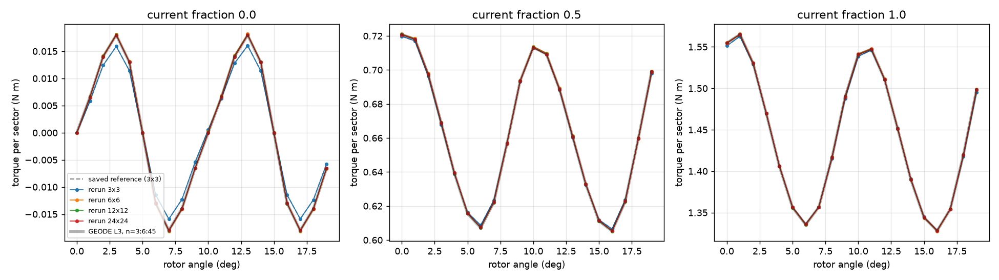

# ICEM reference rerun at finer IGA subdivisions

Motor paper experiment 3, issue #1189. It follows up
[`../forward_harmonic/`](../forward_harmonic/README.md) (#1170). With the
reference's harmonic coupling (n = 3:6:45), GEODE's L3 load ripple is within
1.3–1.7% of the saved reference. The cogging waveform has the same shape,
but GEODE's amplitude is about 1.13 times larger: std 0.01209 against
0.01071 N m, +12.9%. The one cause left open there was the reference's own
discretization: degree-2 IGA with 3×3 elements per patch.

This study reruns the reference's own MATLAB code under Octave at 3×3, 6×6,
12×12 and 24×24 subdivisions per patch. Everything else is kept fixed:
degree, quadrature, harmonic orders, torque definition, Newton stop and
angle grid. Nothing was tuned toward GEODE.

**Verdict (measured).**

- **The setup reproduces the saved arrays.** At 3×3 the Octave rerun
  matches all 60 saved torques (3 currents × 20 angles) to at most
  9.7e-13 N m. The largest saved torque is 1.56 N m.
- **The coarse reference discretization accounts for the cogging gap.**
  The reference's cogging std is 0.01071, 0.01220, 0.01212 and 0.01208 N m
  at 3×3, 6×6, 12×12 and 24×24. The first refinement adds 13.9%. The next
  two change it by -0.7% and -0.4%. At 24×24 the reference is within 0.1%
  of GEODE's L3 value (0.01209), and the largest pointwise gap is 3.4e-5 N m,
  against 2.1e-3 N m for the saved array. The refined reference lies inside
  GEODE's L3 band [0.01190, 0.01228]. The saved array lies outside it.
- **Load ripple and mean torque move too, but much less.** From 3×3 to
  24×24 the load ripple changes by +1.3% (half current) and +1.0% (full
  current). The mean torque changes by at most 0.06%. At 24×24 GEODE's L3
  load ripple is 0.35% and 0.27% above the refined reference. Its mean
  torque is within 0.01%. The refined values lie inside GEODE's L3 bands for
  both currents.
- **The refined reference is close to converged, but not exactly.** The
  cogging increments are +0.00149, -0.00008 and -0.00004 N m. If they kept
  halving, the limit would be about 0.0120 N m, 0.3% below the 24×24 value.
  This is an estimate from three increments, not a bound. The residual
  difference from GEODE is therefore of the same size as either solver's
  remaining discretization change.
- **The Newton stop is not a factor.** Tightening the stop from the
  upstream 1e-6 to 1e-14 on the squared residual moves no cogging torque by
  more than 4.4e-8 N m at 3×3, 6×6 or 12×12.

The saved reference is the input of the published optimization, and it
under-resolves the zero-current cogging amplitude by about 11% (0.01071
against 0.0120–0.0121 N m from refined runs). This changes how its ripple
objective should be read. It does not change any GEODE number.



## Results

All tables are generated by `analyze.py` into `tables.md`; the same data is
in `summary.json` and `torque_table.csv`. Torque is per modelled 60-degree
sector and includes the axial length. Std is the population std over the 20
angles 0, 1, ..., 19 deg, the reference's ripple metric.

### Per-subdivision statistics

| current | subdivisions | DOF rotor+stator | mean | std | d std vs previous | max pointwise increment | std vs saved |
|---|---|---|---|---|---|---|---|
| 0 | 3x3 | 4,079 | 0.00010 | 0.01071 | - | - | -0.0% |
| 0 | 6x6 | 12,518 | 0.00003 | 0.01220 | +0.00149 (+13.9%) | 0.00224 | +13.9% |
| 0 | 12x12 | 43,220 | 0.00001 | 0.01212 | -0.00008 (-0.7%) | 0.00018 | +13.2% |
| 0 | 24x24 | 159,920 | 0.00000 | 0.01208 | -0.00004 (-0.4%) | 0.00008 | +12.8% |
| 0.5 | 3x3 | 4,079 | 0.66208 | 0.03895 | - | - | -0.0% |
| 0.5 | 6x6 | 12,518 | 0.66234 | 0.03973 | +0.00078 (+2.0%) | 0.00137 | +2.0% |
| 0.5 | 12x12 | 43,220 | 0.66209 | 0.03959 | -0.00013 (-0.3%) | 0.00055 | +1.7% |
| 0.5 | 24x24 | 159,920 | 0.66211 | 0.03947 | -0.00012 (-0.3%) | 0.00020 | +1.3% |
| 1 | 3x3 | 4,079 | 1.44248 | 0.07935 | - | - | -0.0% |
| 1 | 6x6 | 12,518 | 1.44340 | 0.08064 | +0.00129 (+1.6%) | 0.00379 | +1.6% |
| 1 | 12x12 | 43,220 | 1.44328 | 0.08027 | -0.00037 (-0.5%) | 0.00068 | +1.2% |
| 1 | 24x24 | 159,920 | 1.44330 | 0.08014 | -0.00013 (-0.2%) | 0.00033 | +1.0% |

"Max pointwise increment" is max over angles of |T_n - T_(n/2)|.

### Against GEODE (n = 3:6:45, tied ends, L3 Arkkio)

| current | subdivisions | reference std | GEODE L3 std | GEODE / reference | max abs pointwise GEODE - reference |
|---|---|---|---|---|---|
| 0 | 3x3 (= saved) | 0.01071 | 0.01209 | 1.129 | 0.00211 |
| 0 | 6x6 | 0.01220 | 0.01209 | 0.991 | 0.00025 |
| 0 | 12x12 | 0.01212 | 0.01209 | 0.997 | 0.00007 |
| 0 | 24x24 | 0.01208 | 0.01209 | 1.001 | 0.00003 |
| 0.5 | 3x3 (= saved) | 0.03895 | 0.03961 | 1.017 | 0.00149 |
| 0.5 | 24x24 | 0.03947 | 0.03961 | 1.0035 | 0.00027 |
| 1 | 3x3 (= saved) | 0.07935 | 0.08036 | 1.013 | 0.00339 |
| 1 | 24x24 | 0.08014 | 0.08036 | 1.0027 | 0.00046 |

GEODE's L3 bands from `../forward_harmonic` (L3 ± max(|d12|, |d23|)) are
[0.01190, 0.01228] for cogging std, [0.03899, 0.04023] and
[0.07914, 0.08157] for load std, and [0.66149, 0.66263] and
[1.44228, 1.44416] for mean torque. The 24×24 reference values (0.01208,
0.03947, 0.08014, 0.66211, 1.44330) all lie inside them. Of the saved
values, the cogging std (0.01071) and the half-current std (0.03895) lie
outside. The cogging waveforms angle by angle, from saved to 24×24 and
GEODE L3, are in `tables.md` ("Cogging waveforms"). At 24×24 every angle is
within 3.4e-5 N m of GEODE.

### Cost and convergence

| job | DOF | setup s | median s/solve | total s | Newton its median / max | max final squared residual |
|---|---|---|---|---|---|---|
| s3_c123 | 4,079 | 17 | 3.8 | 255 | 2 / 7 | 9.3e-7 |
| s6_c123 | 12,518 | 24 | 11.1 | 953 | 2 / 7 | 8.1e-7 |
| s12_c1 | 43,220 | 42 | 43.6 | 1,354 | 2 / 9 | 3.9e-8 |
| s24_c1 | 159,920 | 92 | 178 | 5,935 | 2 / 12 | 2.4e-8 |
| s24_c3 | 159,920 | 92 | 252 | 6,186 | 3 / 4 | 6.9e-7 |

All 240 sweep solves of the main runs met the upstream stop (squared
residual below 1e-6), and the 60 solves of the tolerance runs met the
1e-14 stop (largest final value 3.6e-15). None reached the 50-iteration cap
or fell back to the fixed-point solver; `analyze.py` checks both. The full
table is in `tables.md`. Each Octave process ran at about one core
(`ps` showed about 100% CPU per process).

Wall times are indicative. Eight jobs ran at once on this machine
(Apple M3 Ultra, 28 cores: 20 performance and 8 efficiency, 96 GiB), and
the three tolerance jobs overlapped them. Other unrelated work was also
running (load average about 10).

### Newton tolerance check (zero current)

| subdivisions | std at 1e-6 | std at 1e-14 | max abs pointwise change |
|---|---|---|---|
| 3x3 | 0.0107110 | 0.0107110 | 4.4e-8 |
| 6x6 | 0.0122031 | 0.0122031 | 4.3e-8 |
| 12x12 | 0.0121233 | 0.0121232 | 4.3e-8 |

## Method

`icem_refine_run.m` follows the upstream evaluation script
`results/PMSM_eval_init.m`, with its plots and exports left out:

- The inputs are the iteration-0 NURBS exports (`RotorOpt0.txt`,
  `StatorOpt0.txt`) scaled by ScaleR = 1, length 0.1 m and operating angle
  0. The three peak currents (0, 4.8388..., 9.6776... A) are read from
  `../reference_data.json`, where they were extracted from the history
  file. The 53 MB `OptimizationHistory.mat` is not loaded.
- `FormFunctionDegree = [2,2]` and `DegreeQuadrature = degree + 1`. Only
  `SubdivisionsPatches{Rotor,Stator}` changes, and it is the same for every
  patch (17 rotor and 114 stator patches). The solution space is degree-2
  C¹ B-splines on the refined knots. The geometry stays the exact NURBS map
  at every level.
- Boundaries, phases, the magnet remanence and the coupling harmonics
  (sin and cos, n = 3:6:45, 16 multipliers) are those of the upstream
  script. Torque is `calcTorqueCoupling`.
- The run order follows upstream. The sweep is preceded by a full-current
  Newton solve at 0 deg, which warm-starts the first sweep solve, as it
  does upstream. Then, for each current in order and each angle 0:1:19,
  the driver rotates, sets the current, runs Newton from the previous
  solution and records the torque. The 3×3 and 6×6 runs use the upstream
  chain over all three currents (`s*_c123`). At 12×12 and 24×24 the three
  currents run as separate processes (`s*_c1`, `s*_c2`, `s*_c3`), each
  warm-started from the full-current solve. The tolerance check bounds the
  effect of the starting state at the 1e-7 N m level, for zero current.

### Software and untrusted-code handling

| component | version / source | identity |
|---|---|---|
| Octave | Homebrew bottle `octave 11.3.0_1` (arm64), OpenBLAS 0.3.34, LAPACK 3.12.0 | bottle sha256 `b4f50de10c1539deed7f97649dae152cd23536648796abd2cf936cfbf9dbb2c2` (Homebrew formula record) |
| ICEM snapshot | github.com/MichaelWiesheu/ICEMsnapshot | commit `b145aaf4ab1a6424828bc941eaf172f48fa0d458`; all 23 files in `../sources.json` hash-verified |
| GeoPDEs | github.com/rafavzqz/geopdes, official | commit `53ae5ca1ce16fe81057047831cecbaa859c49080` (`v3.4.2-4-g53ae5ca`, tree `c6676057c47d67a343e2844630a4d0741f1e3b59`) |
| nurbs | Octave Forge `nurbs-1.4.3.tar.gz` (SourceForge) | sha256 `a74666a1e204b9feda22c9792b87939239221fd816383bc39f75db72b62a209b` |
| OS / CPU | macOS 27.0.1 (26A434), Apple M3 Ultra | `logs/setup_checks.log` |

The ICEM snapshot bundles its own GeoPDEs 3.4.2 and nurbs 1.4.3. The
official sources above are the ones used for the runs.
`logs/setup_checks.log` shows that they are byte-identical to the bundled
copies (`diff -rq` is empty). The bundled GeoPDEs is not the v3.4.2 tag:
four files differ. The tag's `mp_geo_load` takes no tolerance argument, and
`MotorSimulation.importSurface` passes one. The bundled copy matches
upstream master four commits later, which includes "tolerance added in
mp_geo_load" (merged from the ICEM author's fork). Both GeoPDEs and nurbs
are put on the path as plain `.m` sources (no `pkg install`, no compiled
`.oct` files), as MATLAB would run them.

All third-party code is kept outside the git worktree, in
`/Volumes/Stripe/scratch-icem-ref/`: `icem/` (pristine clone),
`icem-octave/` (patched copy), `geopdes-official/` and `nurbs-forge/`. No
upstream code is committed here. Before running, the upstream sources were
read for network, shell and file-system calls. The only file writes in the
solver class are ParaView exporters, which are not called. The optimizer
class, which saves files, is not used. The driver adds only the needed
upstream directories with `addpath` and never changes into an upstream
directory. Octave runs with `--no-init-file --norc`.

Octave needs four textual changes to the snapshot. `prepare_octave_tree.py`
verifies the pinned commit and all manifest hashes, copies the needed
directories into `icem-octave/`, and applies exactly these substitutions,
each with a fixed expected count. They are recorded with before and after
hashes in `logs/prepare_octave_tree.log` and `logs/setup_checks.log`.

- `x == "string"` comparisons of different-length char arrays become
  `strcmp`: 5 sites in `MotorSimulation.m` (`getType() == "nonlinear"`),
  3 in `Mat_Magnetic.m` and 2 in `PMSM_rotor1.m`. In MATLAB these are
  string-scalar comparisons. In Octave they are element-wise and fail.
- `fnder` (Curve Fitting Toolbox), used once to differentiate the PCHIP
  H(B), is supplied by `shims/fnder.m`, a one-line call to Octave's
  `ppder`.

Octave's `pchip` and the MATLAB one could have differed. The 3×3
validation (9.7e-13 N m) shows that any difference is not visible in the
torques. On exit, Octave prints a harmless warning about the
`delete`-method conflict in the material class hierarchy, which uses
multiple handle inheritance.

## GEODE curved or higher-order geometry (acceptance item 3)

This is not supported for this solve, and it was not built here (out of
scope). The nonlinear sector solver behind `../forward_harmonic`
(`assembly/magnetostatic_sector.rs`, `magnetostatic_nonlinear.rs`) is P1 on
straight-sided triangles. GEODE has a linear P2 magnetostatic path
(`assembly/magnetostatic.rs`, issue #472). It has straight-sided elements,
no nonlinear law, and no sector coupling. Given the result above, the
cogging gap no longer needs a geometry explanation on the GEODE side. A
curved-element comparison would now test GEODE's own convergence, not the
gap.

## Reproduce

Setup (one time), outside the repository:

```sh
brew install octave            # 11.3.0_1 here
R=/Volumes/Stripe/scratch-icem-ref; mkdir -p "$R" && cd "$R"
git clone https://github.com/MichaelWiesheu/ICEMsnapshot.git icem
git -C icem checkout b145aaf4ab1a6424828bc941eaf172f48fa0d458
git clone https://github.com/rafavzqz/geopdes.git geopdes-official
git -C geopdes-official checkout 53ae5ca1ce16fe81057047831cecbaa859c49080
mkdir nurbs-forge && cd nurbs-forge
curl -LO "https://downloads.sourceforge.net/project/octave/Octave%20Forge%20Packages/Individual%20Package%20Releases/nurbs-1.4.3.tar.gz"
shasum -a 256 nurbs-1.4.3.tar.gz   # a74666a1...
tar xzf nurbs-1.4.3.tar.gz
```

Then, from the repository root:

```sh
RR=benchmarks/motor_reference/reference_refinement
python3 -I $RR/prepare_octave_tree.py --src "$R/icem" --out "$R/icem-octave"
(cd $RR && ICEM_REF_ROOT="$R" ./run_all.sh s3_c123 s6_c123 s12_c1 s12_c2 s12_c3 s24_c1 s24_c2 s24_c3)
(cd $RR && ICEM_REF_ROOT="$R" ./run_all.sh s3_c1_t14 s6_c1_t14 s12_c1_t14)
uv run --with numpy==2.5.4 --with matplotlib==3.11.2 --with pillow==11.3.0 \
    python -I $RR/analyze.py
```

The analysis also reads `../forward_harmonic/runs/L*_h45.json`, which are
committed.

`logs/run_all.log` and `logs/run_tolerance.log` are the batch logs. Their
"done" lines have empty summaries, and `run_all.log` ends with a stray
`ave-cli: command not found`. Both come from editing `run_all.sh` while
the first batch was running (the summary grep was fixed, and the tolerance
suffix was added). Bash reads a script incrementally, so the edit
corrupted the tail of the running copy. Each job's own log
(`logs/<job>.log`) is complete and ends with its statistics and total wall
time. Every job wrote its record.

| file | content |
|---|---|
| `icem_refine_run.m` | Octave driver (written for GEODE) |
| `shims/fnder.m` | `fnder` stand-in (written for GEODE) |
| `prepare_octave_tree.py` | hash check, copy and Octave substitutions (written for GEODE) |
| `run_all.sh` | parallel batch runner |
| `analyze.py` | tables, summary and figure |
| `runs/s<N>_c<currents>[_t<k>].json` | per-job records: torques, per-solve wall time, DOF counts, settings, Octave version |
| `logs/` | per-job console output (Newton history per solve), batch logs, `setup_checks.log`, `prepare_octave_tree.log`, `analyze.log` |
| `torque_table.csv`, `summary.json`, `tables.md` | all tables |
| `reference_refinement.png` | the figure |
